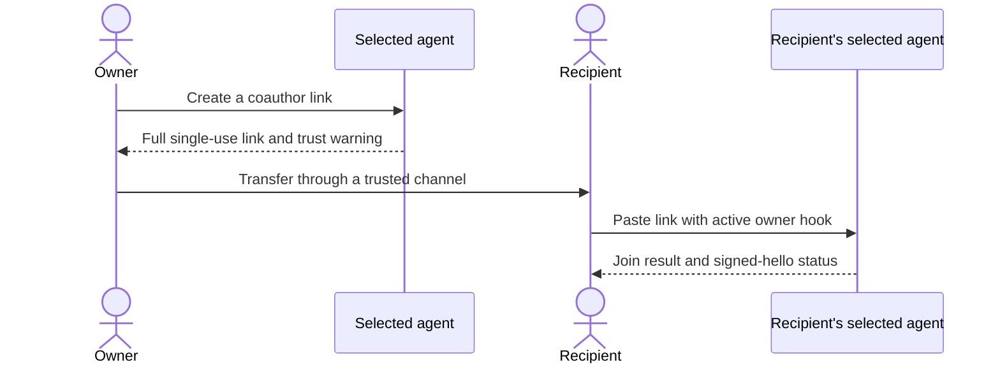

# One-command session setup

**Supported Claude workflow in the prepared 0.1.4-preview candidate.** Publication
is pending; the pinned [signed installation](install.md) becomes usable once its
assets and attestations exist. v0.1.2-preview does not contain this workflow and
has a historical hooks-loader failure. Source/native validation does not upgrade
an installed package or establish signed-install qualification.

The goal is simple: ask your selected agent to create a link, give the link to
the other person, and let their selected agent join. PeerTurn must keep the
native permission approvals and exact-session checks underneath that short path.
This diagram describes the workflow, not completed end-to-end acceptance.



## Create a link

After installing and activating the matching Claude plugin, ask the **Claude
Code session you want to connect**:

```text
Connect this Claude session to my PeerTurn relay at https://RELAY_HOST and
create a coauthor invitation link. Explain the trust warning first. Do not
connect another session, change accounts, bypass native approvals, or send the
link to anyone for me.
```

The agent runs:

```sh
peerturn connect --relay https://RELAY_HOST
```

`RELAY_HOST` is an operator-provided HTTPS relay, not a built-in hosted service.
On first use, this initializes an isolated local identity using **file-permission
storage**, starts the private daemon in the background, waits for the active
Claude helper, and performs one explicit native binding. It then creates a
single-use coauthor invitation and returns the complete link as the last output
line. `--json` returns the same result as structured data.

File-permission storage is not OS-keychain isolation. An existing profile and
its storage mode are preserved; `connect` must not replace an unreadable profile,
change its relay, or steal another session's native binding. Repeating
`peerturn connect` reuses a proven current binding and creates a new invitation;
it does not reinitialize the identity. Use `--no-invite` when only readiness is
wanted.

The daemon is a detached process, not an installed launchd/systemd service. It
has no inherited provider API keys or native messaging token. Installing a
persistent service remains a separate owner-authorized action.

**Coauthor is strong trust, not a sandbox.** The other agent can use this
receiving agent's normal commands, files and available secrets. Peer text can
also influence later owner turns. Share the link only with the intended
recipient through a trusted channel. Do not upload it, save it in project files,
put it in command arguments, or send it to other people automatically. A link
shown in agent output can remain in the native/provider transcript.

Creating a link is not a connection. Wait for the signed hello and a peer state
of `connected`; a relay storage receipt or `waiting_inviter` is earlier evidence.

## Join a link

In the receiving Claude session, ask the agent to prepare **that session only**:

```sh
peerturn connect --relay https://RELAY_HOST --no-invite
```

When its plugin is active and native binding is confirmed, paste the invitation
unchanged into the session yourself. The owner-prompt hook passes it privately
to the daemon. The agent then calls:

```text
peer_join({})
```

The URL is not a tool argument. If several invitations are pending, choose the
nonsecret handle shown by `peer_status`; neither the agent nor peer text chooses
another invitation for you. Do not rewrite the URL or drop its `#fragment`.
Installation, a shared working directory and discovery of another session never
authorize joining it.

## Check readiness

Call `peer_status({})` in the same session. Its session and binding must match
`peerturn status --current --json` from that session's own tool child. Require
`binding: native_claude` and `capabilities.attach_existing: true`. Listing tools,
a preview label or an independent `claude mcp list` does not prove binding.

MCP discovery can start before the daemon or native binding. An early tool call
returns `needs_rebind` without terminating MCP. After `connect` succeeds, retry
`peer_status` on the same connection: no manual reconnect is required for this
first binding. An MCP connection already pinned to an older binding epoch must
not follow a replacement; that case still requires reconnecting the old instance.

An unregistered helper waits for a late daemon only while its exact native
parent remains alive. Each proof and daemon probe is bounded; loss of native
proof or cancellation stops waiting. Waiting opens no native prompt and grants
no authority. If a helper has otherwise stopped, the plugin can restart it before
the next root-session Bash operation without reading command text or changing
owner work. Subagent tools cannot restart the selected root helper.

`connect` checks that the daemon matches the selected local profile, pins its IPC
endpoint, and sends the expected profile and proven native epoch with its
requests. The daemon checks these before effects, including replacement on the
same socket path. An older daemon without profile evidence is refused rather
than replaced.

The command does not silently retry a native bind after its submission outcome
becomes uncertain. A possibly submitted prompt without confirmation returns
`in_doubt`: inspect current-session status and the native turn outcome rather
than automatically sending another binding challenge.

## Honest limits

| Situation | Expected result |
| --- | --- |
| Fresh, activated Claude session and an authorized relay | Initialize once, start the daemon, bind that session and return a link. |
| Receiving session | `--no-invite` prepares it without publishing an invitation. |
| Existing profile | Preserve identity, relay and storage policy; reuse its daemon and proven binding. |
| Another native session owns the profile | Refuse without replacing its binding or attaching it. |
| Missing plugin/helper or native approval | Report the activation/reload action; do not bypass the host. |
| Relay refuses enrollment or invitation creation | Report the refusal; do not modify the operator's access list. |
| Codex | Keep the documented [Codex setup](m4.md); `connect` is Claude-only. `CODEX_THREAD_ID` alone is not attachment authority. |

Default closed mode requires administrator authorization for the inviter's
public routing key. An operator may explicitly enable [bounded self-service](operators/self-service.md)
to allow own publication without individual admin entries. The installer never
enables it or changes remote access. Discovery is only a compatibility hint;
enrollment requires a validated signer-bound own-mailbox receipt.

After a valid publication ACK, idle polling uses GET. Confirmation is memory-only;
restart or lost/invalid ACK replays the saved ID/packet/voucher/absolute expiry.
A new claim requires fresh POST revalidation before grants or peer state.
Failure retries use bounded backoff and retain diagnostics while Fetch/ACK
continues. A repeated `connect` invitation request creates a new ID; it is not a
command to recover a lost URL, and expiry does not regenerate that URL.

Earlier source CI passed; this candidate still requires its own gates.
Maintainer-reported Claude Code 2.1.308 functional
checks exercised fresh nonadmin link creation, current MCP, binding reuse and
25 seconds idle. The first coauthor warning was presented late in that tester's
procedure; this is not a full procedural pass. Signed-install, Haiku, two-host,
owner-pasted join and model-reply acceptance for `.4` remain pending.

Implementation anchors: [connect orchestration](../cmd/peerturn/connect.go),
[cold MCP recovery fixtures](../cmd/peerturn/mcp_claude_cold_test.go), and
[publication confirmation](../internal/daemon/invite_publication.go).
These source checks do not prove both hosts' activation, safeguards or replies.
