# Self-service invitation admission

_Prepared 0.1.3-preview candidate — operator configuration, not deployment authorization_

---

This feature is implemented in the candidate; publication is pending. It is
absent from v0.1.2-preview. Integrated source CI and real temporary TLS/SQLite
two-daemon tests passed. Those synthetic sessions are not native binding, model
reply or Internet deployment evidence. Signed-install, Haiku, two-host and
owner-pasted native join/reply acceptance remain pending. See the
[relay operator guide](relay.md) and [Claude client workflow](../connect.md).

## 🔐 Choose the admission policy

The default is `closed`: ordinary clients cannot register themselves as inviters.
The existing administrator/voucher enrollment path remains available. Installing
a client, discovering a relay or sharing a directory never changes this policy.

The `self_service` mode allows a signed publisher to create its own
mailbox and one encrypted invitation in the same transaction. It does not allow
public creation of arbitrary mailboxes, administrative access, or reading other
mailboxes. The author is taken from the verified HTTP signature, not the body.
All HTTP publishers, including administrator keys, use this bounded publication
path while self-service is enabled.

The workflow below is a policy description, not native acceptance evidence:

```mermaid
flowchart LR
    accTitle: Separate Admission From Peer Authority
    accDescr: The operator enables bounded publication, but connection still requires an owner-transferred link and separate recipient-issued grants.
    operator_opt_in[Operator opt-in] --> signed_publication[Signed own publication]
    signed_publication --> atomic_custody[Atomic mailbox and ciphertext custody]
    atomic_custody --> owner_link[Link returned to owner]
    owner_link --> owner_paste[Recipient owner pastes link]
    owner_paste --> recipient_grants[Separate recipient-issued grants]
    recipient_grants --> signed_hello[Signed hello and connected state]
```



Relay admission is not an E2E grant. `link_ready` is not `connected`, and a storage
receipt does not prove native acceptance, model input, completion or a useful reply.

## ⚙️ Configure explicit operator opt-in

Only the relay operator selects the mode. A client installer must not edit a
remote relay's configuration or add its user to `admin_keys` automatically.
Keep the existing TLS, exact public authority, private listener and operator
routing keys from the [base configuration](../../packaging/docker/relay.toml).

Place `admission_mode` at the TOML root, **before the first table**. Do not append
it underneath an existing `[limits]` table. The separate policy table is:

```toml
admission_mode = "self_service"

[self_service]
active_invites = 4
daily_invites = 20
lifetime_invites = 128
inviters = 100
```

Omitting the mode means `closed`; configuring limits alone does not enable it.
Unknown modes, wrong types, nonpositive limits and inconsistent limits are
rejected. Accepted ranges are active 1..128, daily 1..1024, lifetime 1..65536 and
inviters 1..10000. The invitation caps must satisfy `active ≤ daily ≤ lifetime`.
Operator administrator keys are still required for administrative actions; a
new ordinary inviter does not need an individual administrator entry.

The self-service discovery hint is compatibility information, not authority.
It is omitted in closed mode for old strict decoders. All participants using an
opted-in relay need an upgraded client that understands the hint; do not assume
that an older client can use an open-mode deployment.

The optional signed `require_own_mailbox: true` request requires an ACK with the
same invitation ID and `mailbox = SHA256(raw signing public key)`. The proof key
is not that signer. A cached hint plus a legacy ID-only response cannot establish
enrollment. A closed-mode new legacy publication cannot satisfy this requirement;
the existing closed admin flow without it remains compatible.
An exact author-owned retry of an already published self-service invitation
remains possible after switching to closed mode; it cannot create another record,
adopt a legacy invitation, extend expiry or bypass block/revoke.

## 📏 Understand the finite budgets

| Limit | Default | What remains charged |
| --- | --- | --- |
| Active invitations per routing key | 4 | Unrevoked, unexpired invitations, including claimed slots. |
| New invitations per rolling 24 hours | 20 | Creation history, including failed-outcome recovery whose publication committed. |
| New invitations per routing key lifetime | 128 | Retained history after claim, revoke, expiry or mailbox deletion. |
| Registered self-service inviter keys | 100 | Both active and blocked records; deleting a mailbox does not release a slot. |
| Invitation TTL | At most 600 seconds | The server checks its clock; a retry cannot extend an invitation. |
| Shared self-service custody | One quarter of both effective byte and metadata-row capacity | Registry and retained invitation rows, claim ciphertext and own/voucher-descendant mailbox custody. |

An exact retry uses the same invitation ID, packet, proof key, voucher and expiry;
it does not spend another creation slot. A changed request is not an exact retry.
After a validated ACK and required enrollment save, the daemon retains a bounded
in-memory confirmation for idle GET polling. Restart or lost/invalid ACK requires
exact POST replay. The first new claim always revalidates publication with POST
before issuing grants or installing peer state. Retry failures back off from
2 seconds to at most 2 minutes, preserving diagnostics and other peers' Fetch/ACK.
The default durable nonce cap stays eight; no quota/history reset is used.
Normal quota pressure must leave existing Fetch/ACK/revoke recovery available;
this is not a guarantee against physical disk failure or database corruption.
If the initial three rows do not fit within the metadata quarter, admission is
refused without partial registration; no minimum allowance consumes the whole
small global budget. Non-growing exact retries remain possible under pressure.

These are **per-key limits**, not verified-person limits. A new key consumes a
new registry slot. Sybil activity can exhaust the shared finite allowance; there
is no promise of human identity verification or DoS immunity. The lifetime and
registry limits deliberately make this preview finite, not an indefinitely
replenishing hosted service. Limit changes are an explicit operator action.

## 🗄️ Preserve history during upgrades

The candidate relay uses SQLite schema v2, **even with admission closed**.
Opening a fresh database or upgrading
v1 adds the inviter registry and invitation author/creation-time fields in one
transaction. Legacy invitations retain unknown authorship rather than acquiring
a guessed owner. Unknown schema versions are refused. Transactional migration
tests are not evidence of a live deployment migration; none is claimed here.

There is no automatic v2-to-v1 downgrade. Before an operator-authorized upgrade,
retain a consistent backup and compatible binary; do not expect the old relay
to open a migrated database. Do not edit `user_version` or delete quota/revocation
rows to make a rollback appear compatible.

Restart preserves quota and block history. Restoring an older disk image can
restore older history; it is not equivalent to restart. Follow the existing
[closed-restore procedure](relay.md#capacity-recovery-and-backup), reconcile revocation and
quota history, and obtain explicit operator approval before re-enabling access.

## 🛑 Revoke without expanding authority

`DELETE /v1/invites/{invite}` permits the retained author or an administrator to
revoke an existing invitation. The invitation proof key is not administrative
authority. Unknown IDs return `not_found`/404 without creating tombstones.
Admin-only `DELETE /v1/admin/inviters/{inviter}` durably blocks a registered
inviter, fencing publication, claim and voucher enrollment. Unknown keys return
`not_found`/404 without allocating a block row.

Turning off self-service stops new self-service publication; it does not revoke
existing invitations or recipient-issued grants. Likewise, relay block/revoke
cannot undo an already processed local claim or effects of an admitted coauthor
turn. Existing connected grants require the local grant-revocation procedure.

Coauthor is strong trust with the receiving agent's normal capabilities, not a
sandbox. Peer text can influence later owner turns. Transfer the complete link
through a trusted channel, preserve its fragment, and use the active owner-prompt
hook before `peer_join({})`. Never put the capability URL in command arguments,
project files or logs. Its intentional agent output and owner paste can remain
in native/provider transcripts.

Source contracts: [configuration](../../internal/relay/config/admission.go),
[publication receipts](../../internal/relay/invite_create.go),
[quota accounting](../../internal/relay/store/self_service.go), and
[transactional migration](../../internal/relay/store/migration.go).
