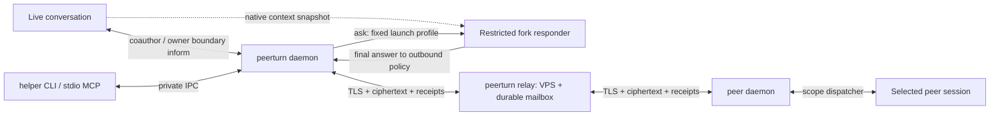

# Design v1

2026-10-21, following the owner's M0/M0b decision. **Design contract**, not a finished implementation: at the time, the product was a Go help/version CLI. Normative requirements: [requirements.md](requirements.md); trust boundaries: [security.md](security.md); acceptance: [plan.md](plan.md). New fields/IPC below belong to PeerTurn, not native Claude/Codex APIs. The [Russian original](ru/design.md) preserves the historical text.

Publication note: private paths are replaced by stable archive identifiers; original line references are retained. See the [historical citation key](../README.md#historical-citations).

## 1. Name and collision check

Approved: **PeerTurn**, executable `peerturn`, directory `<project-root>`, Apache-2.0 license. The historical name search below is retained; it is neither a fresh check nor an open owner decision. The local directory is redacted for publication.

Public `curl -sS` check on 2026-10-21, starting **12:10:31 UTC**: GitHub `https://api.github.com/search/repositories?q=<name>%20in:name&per_page=100`; npm `https://registry.npmjs.org/<name>`. Compared case-insensitive `name`, HTTP status, `total_count`, first 100 results. This checks collisions, not name or trademark registration.

| Name | GitHub | npm | Decision |
|---|---|---|---|
| `agent-link` | HTTP 200, 2,269 name-search hits, 27 exact in first 100; [Riccardo8888/agent-link](https://github.com/Riccardo8888/agent-link) — “An end-to-end encrypted channel between coding agents, anywhere”; also `dmitry-ra/agent-link` | HTTP 200, `agent-link`, latest `0.0.0`; [registry record](https://registry.npmjs.org/agent-link) | Name and purpose collision |
| `turnlink` | HTTP 200, total 1, exact [digitARTI/turnlink](https://github.com/digitARTI/turnlink) | HTTP 404 [record](https://registry.npmjs.org/turnlink) | Do not choose |
| `peerturn` | HTTP 200, total 0 | HTTP 404 [record](https://registry.npmjs.org/peerturn) | Recommended; availability only at query time |
| `sessioncourier` | HTTP 200, total 0 | HTTP 404 [record](https://registry.npmjs.org/sessioncourier) | Longer fallback |
| `agentwire` | First query HTTP 200, exact [tcballard/AgentWire](https://github.com/tcballard/AgentWire), [DanixMP/AgentWire](https://github.com/DanixMP/AgentWire); repeat HTTP 403 rate limit, not a negative result | HTTP 404 [record](https://registry.npmjs.org/agentwire) | Collision |

Repeat exact-name check before publication; npm namespace for optional adapter: `@<publisher>/peerturn-claude`. npm is not required to install the Go helper.

## 2. Components and processes



- One Go binary with `daemon`, `relay`, `mcp`, `hook` subcommands and user CLI. One client daemon per OS uid, thin stdio MCP proxy, short-lived hook process. Relay can use the same binary in a separate container. No Node/Python daemon in core.
- Daemon holds keys, durable queues, grants, transport, scope dispatcher, and responder supervisor. Minimal adapter delivers coauthor, offers inform on owner boundary, and obtains native snapshot handle. A separate runtime/OS restricts ask, rather than an optional hook or model. Live owner permission mode does not change.
- Client IPC: Unix socket mode 0600 in directory 0700, uid/process-incarnation check; native Windows later through named-pipe ACL. No default TCP listener. Mod↔helper: `$.process.spawn` with fixed argv and framed stdio; L1-confirmed local long-poll HTTP is allowed only as a compatibility backend with per-session capability and loopback bind. Direct stdio mod stream is **unverified**, LAB-CC-IPC; until then use L1 long-poll, without plaintext on external relay.
- Relay: HTTP API, WSS event stream, SQLite WAL, bounded workers, one writer transaction path. No broker/Redis/PostgreSQL dependency. SQLite driver is exactly pinned and checked in M1; no custom database engine.
- WSS push only notifies of available seq; durable HTTP mailbox fetch is the source of truth. Reconnect loses no data and starts no model without newly admitted input. Clients use outbound 443, so architecture suits NAT; real Internet/TLS/NAT is **unverified**, LAB-NET.

Borrowings: custody/outbox and `in_doubt` from `R1:825`; mesh transport separate from authority — `R2`; private local bridge `<sender-resolution>` (`BRIDGE:source-A:24`), `<private-ipc-directory>` (`BRIDGE:source-B:101`), `<registration-cleanup>` (`BRIDGE:source-B:115`), `<asynchronous-receipt-tail>` (`BRIDGE:source-C:41`). The last is suitable for receipt observation, **not** a synchronous guard: text search in a delayed rollout does not prove origin before the first tool.

Do not adopt automatic publication of all Codex threads as pseudo-peers (`BRIDGE:source-D:7`), local unknown-sender delivery, global workspace keys, or body control. L2 actually found fan-out through shared identity and `ctrl:despawn`: `L2-RAW:rt-shared-identity-fanout-result.log:2`, `L2-RAW:agmsg-expert-canary-control.log:2`.

## 3. Identity, keys, and grants

| Entity | Fields / lifetime |
|---|---|
| `Identity` | `identity_id=SHA256(root_public_key)`, Ed25519 root; optional local display name is not authority |
| `DeviceCertificate` | Root-signed JWS: `device_id`, Ed25519 device public key, validity, `device_epoch`; daemon does not need root key for every send |
| `SessionCertificate` | Device-signed JWS: random `session_id`, `session_epoch`, Ed25519 session signing key, X25519 recipient encryption key, `key_epoch`, expiry. Native UUID/cwd/socket never reach relay |
| `LocalBinding` | `session_id → platform/native_session_id/instance_id/native_process_start/uid/adapter_build`; binds a specific execution context, not a name |
| `Grant` | Recipient session signs: `grant_id`, issuer identity/device/session/epoch, subject identity/device/session/epoch/signing key, `scope`, `grant_epoch`, `not_before`, `expires_at`, limits, allowed reply route; default policy authority local, optional `policy_authority_key/policy_epoch` of another owner device only for policy leases/revoke. No wildcard sessions or peer right to issue grants |
| `RoutePermit` | Separate relay ACL: mailbox owner allows routing public key to write to one mailbox until expiry with quota/permit_epoch. Reveals no scope, session name, or message body |

Default grant 24 h, renewed under previously agreed owner policy; maximum 30 d, explicit expiry. Join creates two directional grants: owner preselects colleague→self scope; colleague confirms owner→self scope. Trust in one's own second device does not imply auto-attach of all its sessions. Team is an address book and explicit fan-out of N independently signed/encrypted messages; team admin cannot grant access to another receiving session.

Root keys are generated/stored locally; export/import to a new device is a separate owner operation. OS keychain stores wrapping key, key files 0700/0600, unlocked keys memory-only; Linux without keychain uses an explicit encrypted keyfile/passphrase at startup or explicitly selected file-permissions mode. Copying state directory is not an authorized identity transfer. Device/session private keys never go to relay, LLM, or peer. Same-uid local compromise remains outside the protection boundary.

## 4. Cryptographic profile

Chosen: **HPKE RFC 9180 Base mode**, suite `DHKEM(X25519,HKDF-SHA256)` / `HKDF-SHA256` / `ChaCha20Poly1305`, IDs `0x0020/0x0001/0x0003`, plus **Ed25519 JWS** for certificates, grants, and inner payload signatures. HPKE provides asynchronous encryption for offline recipient; verified signature, not Base mode, provides sender authenticity. No custom DH combine, nonce schedule, ratchet, or algorithm “enhancements.” [RFC 9180](https://www.rfc-editor.org/rfc/rfc9180.html), [JWS EdDSA/RFC 8037](https://www.rfc-editor.org/rfc/rfc8037.html).

Go implementation baseline: pinned supported patch release with public `crypto/hpke`; at documentation-check time **go1.27.2** was available, including DHKEM/X25519, HKDFSHA256, ChaCha20Poly1305 and `NewSender`/`NewRecipient`. Use `crypto/ed25519`, `crypto/ecdh`, `crypto/rand`, `crypto/sha256`; Go stdlib HPKE, not copied RFC pseudocode. M1 pins exact toolchain/digest; API availability on build machine was **unverified**. [Go HPKE documentation](https://pkg.go.dev/crypto/hpke).

New HPKE context for **every** message; `NewSender` → one `Seal(aad, plaintext)`, then destroy context. Wire stores separate `enc` and `ciphertext`; network retry sends identical ciphertext without re-encrypting. `info` is fixed ASCII `peerturn/v1/envelope`; AAD is exact UTF-8 bytes of canonical routing header containing version, suite, destination mailbox, permit ID, message ID, recipient key epoch, expiry. Serialize header once under RFC 8785; parser rejects duplicate keys/unknown critical fields. Relay-assigned seq is outside sender signature: it appears later.

Inside HPKE: JWS Compact Serialization over JSON payload; `alg=EdDSA`, Ed25519 only, fixed `typ=peerturn-message-v1`, protected `kid`; no `none`, algorithm negotiation, `jku`/`x5u`/remote key fetching. Verify original JWS payload bytes before JSON parse; canonical form gives predictable digests rather than replacing signature verification. Destination, IDs, grant hash/epoch, body, conversation chain are signed. This standards composition is our application profile, requiring M1 interop/security review; it is not a claim of independent product audit.

| Alternative | Why not the v1 foundation |
|---|---|
| Noise | Good for online authenticated stream and FS with correct pattern; offline store-and-forward would also need durable session/ratchet lifecycle. No custom extension. Public keys still need pins. `R3-N:sec-noise.txt:868`, `:919` |
| age v1 | Reliable existing file/container format, suitable for encrypted backup; sender authentication and session grants remain separate. HPKE with AAD chosen for short typed messages; age alone does not supply required delivery semantics. [age specification](https://age-encryption.org/v1) |
| MLS RFC 9420 | Provides group epochs, FS/PCS; justified for large dynamic groups, excessive for pairwise grants in a 3–10 person team. MLS needs separate Go implementation selection and interop; v2 research. [RFC 9420](https://www.rfc-editor.org/rfc/rfc9420.html) |

**No forward secrecy/PCS promise**: compromise of an active recipient private key exposes stored ciphertext for that key epoch. Daily rotation with old-key deletion narrows the window without turning HPKE into a double ratchet; backups may widen it. If FS becomes mandatory, add a separate standard messaging stack/MLS milestone, not custom prekeys.

## 5. Envelopes, queues, and receipts

```text
RoutingHeader = {wire_version, suite, dst_mailbox, route_permit_id,
                 message_id, recipient_key_epoch, expires_at}
EncryptedPacket = {header, enc, ciphertext}
MessagePayload = {message_id, from_session, from_session_epoch, to_session,
                  to_session_epoch, sender_seq, grant_id, grant_epoch,
                  grant_hash, kind, body_utf8, created_at, expires_at,
                  conversation_id, parent_id?, reply_to?, hop, budget_id}
ReceiptPayload = {message_id, attempt_id, stage, evidence_kind, at,
                  delivery_context, outcome?, reason_code?}
LocalRun = {run_id, message_id, attempt_id, parent_binding, snapshot_handle,
            fork_native_id?, model, effort, profile_hash, budget_id, state}
```

`kind` is `inform|ask|coauthor|reply|receipt|key_update|grant_update|revoke`; core handles the last family, never a model or substring parser. Grant scope and kind are checked for compatibility; `reply` is allowed only in an existing conversation to the signed peer, not an arbitrary address. Control objects are signed by the authorized issuer; `kind` does not determine scope.

`message_id`: 128 random bits; `sender_seq`: monotonic uint64 per directional session channel. Relay `mailbox_seq`: monotonic per mailbox, assigned transactionally with UNIQUE(sender route key, message_id) and ciphertext digest. Equal ID/equal digest returns previous receipt; equal ID/different digest →409. Retries use 0.5…30 s exponential backoff+jitter, TTL, unchanged ID/ciphertext; credential refresh does not change message ID.

Receiver atomically persists ciphertext, validated metadata, dedup, grant decision, receipt outbox; cumulative ACK is allowed after commit. Before live submit/fork start/inform boundary, repeat grant/expiry/binding/capability checks. Persist `delivery_intent/attempt_id` before native call, then record queue ID or LocalRun. ACK means custody, not model input. Duplicate returns previous receipt without starting another model.

Crash between submit/spawn and result → `in_doubt`, reconcile by IDs/native events; unknown answer is not forwarded. Queue item disappearance does not prove consumption. No blind retry/fallback for coauthor effects or paid ask. Explicit owner retry uses new message ID with `retry_of` and duplicate effect/cost warning. Supervisor binds child process group to run; after crash, admission stays closed until reconciliation, orphan output never becomes reply.

Ask lane: `receiver_stored → responder_started → responder_input → responder_completed → reply_redacted → reply`; live adapter lane retains `adapter_accepted → model_input → turn_completed`. Inform ends at storage without wake, then may receive owner_mixed model_input. Final answer is buffered whole locally; no tool events/partial output streamed to peer. Redaction and grant/expiry check precede atomic reply outbox commit. Native IDs/snapshot handles are local metadata only; encrypted peer receipts contain opaque attempt ID and sanitized outcome, relay sees ciphertext.

Mailbox ACK accepts only highest contiguous durable seq; gaps are retained. Expired/invalid entries create bounded tombstones to advance cursor without plaintext. `sender_seq` detects replay/gaps even with malicious relay reordering; no absolute global order between peers. Receipts use a separate encrypted control lane with reserved quota, create no response-to-receipt, and never wake model. Detailed stages: requirements §5.

## 6. Relay API and deployment

All APIs use HTTPS; WSS only for transport notifications. Request auth: **RFC 9421 HTTP Message Signatures**, Ed25519 routing key, covering method, authority, target URI, Content-Digest, created/expires, nonce; body digest is actually verified. Clock skew±60 s, request lifetime≤60 s, durable replay cache≥2 min for mutations. M2 hardening clarification: GET uses a separate bounded volatile replay cache through acceptance-window end, without fsync; after restart an otherwise valid GET may replay but performs no ACK/delete/claim. Authority must match configured relay public authority; signature cannot transfer between endpoints. [RFC 9421](https://www.rfc-editor.org/rfc/rfc9421.html); archived research `R3-N:sec-rfc9421.txt:3346`.

| Endpoint | Purpose / authorization |
|---|---|
| `GET /.well-known/peerturn` | Version ranges, public limits, relay key; not a source of E2E trust |
| `GET /i/{invite_id}` | Static HTML/agent-readable instruction and public bootstrap manifest reference; GET does not redeem |
| `POST /v1/mailboxes` | Scoped enrollment voucher or local relay-admin; one bound read key, quota; admin credential never goes to peers |
| `GET /v1/invites/{id}` | Encrypted descriptor, public invite proof key, expiry; no plaintext grants |
| `POST /v1/invites/{id}/claims` | Signed invite proof + encrypted claim; atomically reserve single use; same claim retry idempotent |
| `PUT/DELETE /v1/mailboxes/{id}/permits/{permit}` | Mailbox owner routing key only, monotonic epoch; open streams are reevaluated |
| `POST /v1/mailboxes/{id}/messages` | Valid route permit + bound writer signature; commit→seq receipt; size≤96 KiB ciphertext |
| `GET /v1/mailboxes/{id}/messages?after=…&limit=…` | Mailbox read key only, limit≤100, bounded long poll |
| `POST /v1/mailboxes/{id}/ack` | Read key, contiguous cursor; reject ACK beyond issued range |
| `GET /v1/events` →WSS | Authenticated upgrade, notifications `{mailbox, high_seq}`; no content, grants/scopes, native IDs |
| `POST /v1/streams/tickets` | One-use≤60 s ticket for Monitor notify lane only; not mailbox content/read token |
| `/healthz`, `/readyz`, `/metrics` | Health without secrets; metrics/admin on localhost/private bind |

Status codes: 400 schema, 401 authentication, 403 permit, 409 ID/epoch conflict, 410 expired/revoked invite, 413 size, 426 unsupported major, 429 quota+Retry-After, 503 storage/backpressure. No execute/spawn/read-file/list-native-sessions API. Mailbox enrollment grants no writing access to other mailboxes.

Self-host: `peerturn relay --config /etc/peerturn/relay.toml`, persistent `/var/lib/peerturn`, TLS certificate/key through file secret mounts. Binary supports TLS termination; alternatively Caddy/nginx reverse proxy with trusted proxy headers only from configured IPs. Domain+A/AAAA+ACME certificate issuance are operator steps. Docker image pinned digest, non-root, read-only rootfs, dropped caps, only data/tmp writable, memory/CPU limits. TLS≥1.2, preferably 1.3; no insecure skip verify.

Relay restart preserves mailbox seq, dedup/tombstones, invites/claims/permits, quota, backup epoch. SQLite WAL full durability, consistent online backup, daily restore drill M7; default quota 1 GiB, mailbox≤1,000 items/32 MiB, no silent eviction. ENOSPC gives new writes 503; no `relay_stored` before commit. Backup protects ciphertext/metadata, not private client keys. One relay instance in v1, no multi-writer HA/federation; client may have connections through several independent relays.

## 7. One URL: end-to-end onboarding

**Format** example, not an operating service:

```text
https://relay.example/i/<random-128-bit-id>#v=1&ik=<invite-signing-seed>&ek=<invite-decryption-key>&fp=<inviter-root-fingerprint>&mh=<descriptor-hash>
```

`ik` Ed25519 seed and `ek` X25519 private key are independent, generated with `crypto/rand`; no Ed25519→X25519 conversion. Invitation is a short-lived proof capability, not an active session's encryption/message key. Descriptor is HPKE encrypted to invite encryption public key, containing inviter-signed invitation: both proposed scopes, recipient session certificate, relay origin, 10 min expiry, max_uses 1, publisher/release manifest hash, enrollment voucher for one new mailbox. Relay sees ciphertext, invite verification public key, routing/expiry metadata. Secrets are in fragment and never sent in HTTP GET; **model provider/transcript still sees the full pasted URL**.

1. In an owner turn, `peerturn invite create --current --scope ask --return-scope ask` checks current binding and creates one-use URL. Other scopes are explicit. Inviter daemon retains invitation authority locally; relay gets opaque descriptor and slot.
2. Colleague pastes one URL into agent. Fetch without fragment returns the same short instruction and versioned manifest; link preview activates no grant. The installed agent path follows the owner-prompt handoff decision below; human CLI join reads the full URL from stdin. New agent obtains official signed bootstrap from known publisher origin rather than executing arbitrary shell from relay page.
3. Fresh install: download exact OS/arch artifact, manifest/signature, verify trusted publisher key/hash, extract user-local helper and adapter. First trust root must come from trusted distribution/already installed package manager or explicit human publisher acceptance; signature by key from the same unknown page does not prove trust. Product bootstrap commands are in §10; the human terminal alternative remains `peerturn join --link-stdin --current`.
4. Helper shows **one card**: publisher/version, inviter fingerprint/name, two exact sessions, both scopes, expiry, preserved bypass, actual limitations. Human confirms contact/install once; sender issuance already authorizes owner's side. Native host hook-trust dialogs are not bypassed and counted separately; lab does not yet prove exactly one total click on every host.
5. Helper gets current-session evidence under rules below, creates session keys, decrypts descriptor, verifies signature/fingerprint/hash/expiry. Claim contains new session certificate, reverse recipient-issued grant, requested scope subset, `claim_id`, routing keys; own session signature inside HPKE to inviter. Outer invite-key signature covers invite ID, claim ciphertext hash, claim ID, expiry. Relay reserve and inviter-local consume are each atomic locally; a second different claim is rejected even if malicious relay replays them.
6. Inviter daemon checks proof, own unused slot, issued policy, claims; issues exact forward grant and route permit. Response is E2E to joiner key. Retry after lost ACK returns same result without spending use again. Offline inviter → `waiting_inviter`, no false connected; “just works” assumes available signer or its pre-scoped local service.
7. After scope-specific capability probe and signed hello → `connected` with actual supported scopes. `fork_responder=false` prohibits ask, not coauthor/inform. Hello binds selected live session; ask fork does not substitute its identity. L1 new-thread-instead-of-attach error: `L1:157`.

### Owner-prompt handoff — owner decision, 2026-10-23

This supersedes model transcription of a pasted capability into `peer_join.text`, following mac4/mac5 failures; those historical results are unchanged and this decision is not new live qualification. The eligible owner-prompt hook extracts the capability using the CLI's strict invitation parser and normalization, then sends it over existing private same-UID IPC. Claude binds it to its verified native epoch; Codex binds it to the exact root thread selected on MCP calls by host-owned `_meta.threadId`. Codex 0.163.0 internal Review shares root `session_id` and omits agent fields, so those fields alone cannot prove owner origin. Before recording invitations or offering/acknowledging inform, the daemon requires native root-thread metadata and an exact active `turn_id` match with `rootTurnId == turn_id` from `thread/turns/list` with `itemsView: notLoaded`; unavailable or unknown evidence fails closed. Review can forward child turn events into root history, so turn membership alone is insufficient. Missing/inherited root IDs fail closed, including any unqualified continuation chains. Queue frames remain excluded. This fix has source and regression-test evidence, not a new live `/review` qualification. Same-UID native host/hook IPC remains a trusted local boundary, not independent human-origin authentication.

The daemon keeps at most eight pending capabilities per session, memory-only for at most ten minutes. A new distinct paste evicts the oldest entry, stops its timer and clears its bytes; duplicates do not extend expiry. Use, expiry, unbind/rebind, stop and restart clear them. Claude records eligible composer invitations under the state mutex before waiting for operation serialization, so slow relay I/O cannot discard the paste. No pending secret or pasted prose enters status, logs, receipts, audit or persistence. Existing sealed onboarding recovery state after join begins is a separate lifecycle. The original owner paste still enters native transcripts/provider context.

MCP `peer_join({})` consumes the sole pending invitation and accepts no text/URL/fragment. An optional random opaque nonsecret `handle` selects one entry. Multiple entries → `ambiguous_owner_invitation` with nonsecret `invitations` entries; `peer_status.owner_invitations` exposes the same `{handle, relay_host, routing_hint, age_seconds}` view. `routing_hint` is `/i/` plus six public routing-ID characters, never fragment data. No inviter label before authenticated descriptor verification. None → `no_owner_invitation`; expiry → `owner_invitation_expired`. Hooks discard malformed candidates; direct CLI parsing returns `malformed_invitation`, asking the owner to paste it unchanged. Never reconstruct or repair fragment values. Human CLI `join --link-stdin` and private-file alternatives remain unchanged.

### Claude Code

Agent Bash starts verified helper; it receives `CLAUDE_CODE_MESSAGING_SOCKET` and token from child env **without printing token**. Public export contract: `CC-DOC:cross-session-messaging.md:244`, `:251`; separate end-to-end join through this env in L1 is **unverified**, LAB-BIND-CC. No “latest Claude by cwd” search. Socket binds to OS peer credentials/process start; mod checks `$.session.id()` and helper nonce handshake. Native UUID+process incarnation must match; mismatch→`needs_rebind`.

Helper installs local signed plugin with verified local-path installer: `claude plugin install peerturn --marketplace <verified-local-marketplace> --scope local`; docs describe upstream URL install, live tests used local paths. Human runs `/reload-plugins` if host provides no verified agent command dispatch. First activation, if needed, is **resume of previous UUID**, not new session. Probe hook/tool visibility separately before hello; L1 observed native dispatcher only after activation: `L1:165`.

Live coauthor: Go receiver → mod → `$.prompt.submit({text})`, **without `asUser:true`**; `drop` is not delivery. This is an unrestricted request with explicit verified peer framing. L1 confirmed DeepSeek wake/queue and plugin origin (`L1:64`, `L1-RAW:62-transcript-mod.json:12`); coauthor needs no synchronous required-guard mapping. Ask never calls submit: native fork profile is in §8. Inform: local storage/status and mod UI where available; body only on next owner boundary, without submit/wake.

Native inbox is compatible only with coauthor after separate qualification: verified `peerProtocol=1`, auth + NDJSON, escaping, OS identity; no false `from-mode`. L1 saw between-tools delivery (`L1:40`, `:56`, `:195`), so this is not default next-turn path. Inform/ask must not use native inbox or asyncRewake. Channels/Monitor do not replace scope dispatcher.

### Codex CLI

Helper inside tool child gets `CODEX_THREAD_ID`; env injection source: `CX-SRC:protocol/src/shell_environment.rs:165`. `thread/loaded/list` + exact `thread/read` check that **the same** shared daemon serves UUID; owner's local endpoint is not replaced with new server. Current-session env→join is **unverified**, LAB-BIND-CX. `--no-daemon`/embedded TUI → explicit unsupported live attach, without “fixing” it through new exec/resume process.

Helper installs pinned local marketplace/plugin (`codex plugin marketplace add <verified-path>`; `codex plugin add peerturn@peerturn-local`), adds local stdio MCP and hooks. MCP runtime config reload uses verified `config/mcpServer/reload`; probe live hook activation separately. One native **Hooks need review / Trust all** screen exists even in YOLO: `L2:60`, `L2-RAW:agent-talk-codex-hook-trust.log:1`. Do not claim never bypasses hook trust. Required restart/resume uses explicit same UUID only, checking neighboring threads remain unaffected.

Live coauthor: `codex queue` to exact loaded UUID / pinned `thread/queue/add`, retaining queue/client IDs for receipts/reconciliation. L1 FIFO/idle: `L1:120`, `L1-RAW:59-transcript-codex.json:12`. Queue→turn evidence may be observed, not an invented synchronous fence (M0 `M0:94`). Racing `turn/start` may steer; peer steer/raw inject are not exposed in v1. Ask uses separate `codex exec … fork`, §8; inform never enters native queue.

### Gemini CLI

Package: pinned extension with Go helper hook commands; documented `gemini extensions install <verified-repo> --ref <sha>` with install consent, or local validated package path after LAB-JOIN-GEM. MCP optional; helper sending works without hot MCP. `SessionStart/BeforeAgent` supply `session_id`; hook+child registration nonce binds UUID to pending join; no particular environment variable is **assumed**. Two concurrent same-cwd sessions must not compete for “pending join by cwd.”

Baseline inform: `BeforeAgent.additionalContext` of next owner prompt; pending while idle. Ask without own fork profile → `responder_unavailable`; `AfterAgent` never starts restricted peer turn. Boundary coauthor may be unrestricted owner_mixed with explicit capability. Activation may need restart/resume; `/mcp reload` does not prove hot add. Sources: `GEM-SRC:docs/hooks/reference.md:114`, `:245`; `R3:248`, `:261`. End-to-end **unverified**, LAB-BOUNDARY-GEM.

### Antigravity / agy

Agent installs signed helper/plugin (`agy plugin install <source>`). Do not invent `agy mcp add`. Join binding: **`conversationId`** + process instance; `workspacePaths` is display-only, env UUID **unverified**. Next owner turn's `PreInvocation` offers inform as escaped `ephemeralMessage`; never peer-controlled `systemMessage/toolCall`. `wake_idle=false`, `fork_responder=false`; ask → `responder_unavailable`, coauthor only in explicitly declared unrestricted boundary mode.

Hook fields and injectSteps: `R3-N:ext-antigravity-hooks.txt:372`, `:490`; install: `R3-N:ext-antigravity-plugins.txt:284`; `/mcp` reload: `R3-N:ext-antigravity-mcp.txt:203`. Hook reload, trust dialogs, exact current-session handshake **unverified**, LAB-JOIN-AGY. Restart/resume only under verified runtime contract, otherwise `needs_activation`; no switching to headless stream-json and claiming it is the previous TUI.

### Copilot CLI

Signed helper + pinned plugin (`copilot plugin install <verified-source>`). Hook binding: `sessionStart.sessionId` + process instance; `source=startup|resume|new` does not mean human/peer. Inform on next owner prompt through `userPromptTransformed`, preserving owner prompt and data framing; command/HTTP `userPromptSubmitted` output is **ignored**. Ask without fork profile → `responder_unavailable`, coauthor only at explicitly declared unrestricted boundary. `postToolUse.additionalContext` is limited to 10 KB and not chosen for mid-turn ingress.

Sources: `R3-N:ext-copilot-hooks.md:285`, `:300`, `:404`, `:407`, `:751`. Native Notification wake and SDK `source=agent-…` are separate future paths, not proven attach to current TUI (`R3-N:ext-copilot-sdk-steering.md:20`, `R3-N:ext-copilot-sdk-debugging.md:397`). Hot plugin hooks **unverified**, LAB-JOIN-COP. `/restart` affects **all** live sessions in process, so helper never calls it automatically (`R3-N:ext-copilot-reference.md:589`).

### Optional Claude Monitor: without installation

Host lab: Monitor `ws://127.0.0.1:18795` received task-notification after turn completion and woke idle itself; **observed fact**, despite documented network restriction: `MONITOR:6`. Tool was absent on DeepSeek, so capability probe is mandatory. 30 min lifetime and 200 ms batching are tool-description claims; extended live testing **unverified** (`:10`).

Flow: link → confirmed notify-only invite → short one-use stream ticket → `Monitor({ws:{url:"wss://relay.example/notify/<ticket>"},timeout_ms:…})`; after upgrade, ticket becomes server-side subscription, URL secret redacted. Frame contains only `mail_available` and routing sequence, **not peer body**. At expiry agent may open another subscription, spending another turn; reconnect, flow limits, ticket acquisition without permanent credential: LAB-MONITOR.

Experimental notify-only path: `e2e_content=false, fork_responder=false, content_delivery=false`, not a full bridge. Its idle wake is **incompatible with v1 inform and ask FYI**, so Monitor does not subscribe to those events; separate opt-in experiment does not satisfy FR-11. Relay plaintext is prohibited; E2E fetch requires verified local decryptor. Monitor does not replace durable ACK, session continuity, or installer trust.

## 8. Fork responder, snapshots, and lifecycle

### 8.1 Scope dispatcher and launch

`coauthor` uses only live adapter with receiving agent's normal capabilities; owner pending work has priority. `ask` uses only daemon-supervised fork; `inform` uses durable storage/status/UI and data framing on next owner turn. Ask FYI is configurable: default UI status/count only without wake; body/answer stay out of live by default. Automatic FYI never calls submit/queue/Monitor. Owner may explicitly open inbox/result in their unrestricted turn.

Before spawn daemon checks exact parent binding/epoch, grant, budget, qualified restriction profile; persists `LocalRun`, native snapshot boundary, effective model/effort. Mandatory preflight isolates **authority secrets**: PeerTurn private keys, unlocked state/admission/grant-control credentials, mailbox/routing tokens, live-control IPC. Neither files/env nor inherited descriptors/process inspection may expose them to responder tools. Clean env/absent MCP are insufficient. Without proven isolation → `protected_path_policy_failed`, no spawn/answer. Fork gets no peer grants/mailbox; only daemon signs stdout final answer to original verified peer. Body never constructs argv/settings/native IDs. One-use child correlation is not auto-attach.

Claude baseline from `M0b:10`:

```sh
claude -p --resume <live-id> --fork-session --permission-mode default \
  --allowedTools Read Grep Glob \
  --disallowedTools Bash Edit Write NotebookEdit WebFetch WebSearch Task \
  --settings <private-responder-settings.json> --output-format json
```

M0b verified Write/Bash removal, Read, context; this probe's `--settings` path policy is **unverified** (`:14`, `:37`). `--allowedTools` means approval without prompt, not a closed tool inventory: `CC-DOC:cli-reference.md:67`. Hardened profile must also fix built-ins through `--tools Read,Grep,Glob`, deny `mcp__*`, disable skills/commands and effectful inherited hooks/plugins/MCP. `--tools` / `--strict-mcp-config` are documented (`:138`, `:131`), their complete fork composition is **unverified**, LAB-FORK-CC. Unknown tool/integration → unqualified profile, ask disabled; approval prompt does not become owner approval.

Candidate settings, **not live-verified**, generated by daemon in private regular file; actual absolute paths calculated locally, example is not complete policy:

```json
{"permissions":{"deny":["Read(//<user-home>/.ssh/**)","Read(//<user-home>/.aws/**)","Read(//<user-home>/.local/state/peerturn/**)","Read(//work/project/.env*)"]}}
```

Documented `//` is filesystem root; `/` depends on settings location. Deny→ask→allow priority and path syntax: `CC-DOC:permissions.md:58`, `:352`, `:362`, symlinks `:459`. LAB-FORK-PATHS checks effective resume/default merge, Read/Grep/Glob, aliases/symlinks/races, all protected roots from security §6. Unmatched/ignored rule → `protected_path_policy_failed`, no answer. Do not present snippet as proven protection for every path.

Codex baseline from `M0b:26`:

```sh
codex exec -c sandbox_mode='"read-only"' -c approval_policy='"never"' \
  fork <live-thread-id> "<question>"
```

Illustrates native CLI, not shell interpolation of peer body: implementation uses fixed argv/private input. `-c sandbox_mode` goes **before** `fork`; `--sandbox` after fork is rejected (`:28`). Effective sandbox/network/approval and identical model/effort are checked before peer input; explicit overrides only preserve original model/effort and separate restriction profile. Tool network off does not remove necessary runtime→model-provider communication. Runtime may write metadata/transcripts outside tool sandbox; “read-only” does not mean zero host writes.

Linux: bwrap requires enabled **unprivileged user namespaces**; sysctl alone is insufficient under AppArmor/seccomp/container policy. `doctor` and activation preflight sandbox in same launch environment: allowed fixture read, denied write and tool-network canaries. Userns/bwrap failure → `sandbox_unavailable`, `fork_responder=false`, no tool execution/unrestricted retry; owner/coauthor continue separately. M0b refusal and RO canary: `:30`; source diagnostic `CX-SRC:sandboxing/src/bwrap.rs:28`. `seccomp=unconfined` was a lab condition, not an automatic production fix; do not weaken host policy.

macOS: Codex uses Seatbelt (source `CX-SRC:core/src/sandboxing/mod.rs:179`); live fork+Seatbelt **unverified**, LAB-FORK-CX. Source RO network off: `CX-SRC:protocol/src/protocol.rs:1314`, needs live negative probe. Shell isolation does not prove MCP/hosted-tool safety: exclude effectful services. Stock RO allows broad reads and **does not itself pass authority-isolation gate**. Need proven native read-deny/isolated file view or credential broker/service account with state/IPC/process handles closed; native fork/provider auth composition **unverified**, LAB-FORK-PATHS. After mandatory authority isolation, reading other files remains residual; `protected_paths_enforced=false` never permits reading signer/admission secrets.

### 8.2 Context, framing, concurrency, and cost

Full native context is inherited by local fork, never sent to peer/relay or assembled as attachment. Preserve model/provider ID, effort, persona, native compaction; no summary/cheap model. Context may contain user secrets/injection: residual. Known core exposure of active authority secret blocks ask until revoke/rotation/rebind without trimming owner history. Framing adds verified peer fingerprint, scope/epoch, owner-authorized read/analyze/reply, restrictions/budget, question as data field. It neither makes peer owner nor permits secret disclosure. DeepSeek over-refusal (`M0b:19`) requires benign acceptance testing, not weaker runtime policy.

Snapshot is committed native conversation prefix at a specific boundary. Busy live session: use proven immutable prefix or wait for boundary; torn transcript → `snapshot_unavailable`. Owner keeps working. Record local boundary/context revision and effective model/effort; inheritance of all memory/plugin slots and atomic snapshot on busy runtime **unverified**, LAB-MIX/FORK-CC/CX. Filesystem stays live while read: no atomic code snapshot, answer may become stale; fork merges nothing into live. Reproducible code snapshot requires separately and explicitly selected fixture/worktree, not hidden copy of user files.

Baseline receiver limits (design targets, **unverified**, LAB-FORK-COST): one active fork per parent session, two per daemon, one outstanding ask per conversation; FIFO admission/fair peers, bounded wait/TTL. Explicitly increased parallelism gives each run separate native ID/snapshot/budget/output; completion may reorder. Never re-resume one responder for different grants or accept cancelled run's late output. Owner workload has priority; child CPU/RSS and model costs are visible separately.

**Owner decision, 22 October 2026, v0.1:** monetary funding/accounting is no longer an enablement prerequisite. Before spawn, reserve receiver-owned quotas: default deadline 120 s, ≤8 tool calls, final output≤16 KiB, two concurrent forks per daemon, one per parent/conversation, six asks per peer per rolling hour, and 24 asks per UTC day per daemon. The owner configures the daily count with `ask_per_day` (1..4096). Durable reservations, including failed/ambiguous launches, survive restart; new message/conversation/peer IDs do not reset daily usage. Exceeded quotas refuse the run; no partial reply. Preserve model/provider, effort and full context. Spend per ask is bounded only by these limits and the provider's own behaviour: no reliable dollar ceiling or refund from cancellation is promised. The startup probe is an additional model turn within the same reservation.

The previous design proposed estimated $1/run and $10/day ceilings, with `budget_unavailable` when billing could not be qualified. That proposal is superseded for v0.1 by the dated owner decision above; earlier research did not prove such monetary controls. Native estimates and cache savings remain observations, not billed-cost guarantees. LAB-FORK-COST now qualifies count/deadline/output/concurrency enforcement and discloses provider accounting limits.

### 8.3 Lifecycle and errors

Session states: `unbound → joining → probing → active → offline|paused_owner|needs_activation|needs_rebind|in_doubt → active|revoked|closed`. Ask capability separate: `ready|responder_unavailable|sandbox_unavailable|unverified`; local run: `reserved → starting → running → completed → redacting → reply_committed|failed|cancelled|in_doubt`. Matching session key/epoch allows one live-instance lease; missing lease closes new admissions, not owner tools.

Same-UUID resume on same device preserves grants after keys+host handshake and instance/PID-start change. Rename is a label. New UUID, `/clear`, branch/clone, device/key loss → new identity/epoch; responder is exempt only as local child, gains no own grants. Recheck session events after `/clear`/`/resume`/`/branch` (`R3-N:claude-mod-reference.md:138`). Parent epoch change/revoke cancels run and prohibits reply; running syscall/already read context cannot be rolled back.

Esc/Stop live session sets `paused_owner` and prohibits new automatic admissions; supervisor cancels active responders, discards late output. No auto-retry around stop. Owner input rearms only under local owner policy. `drop`/interrupted queue is not consumption (`L1:81`, `R3-N:codex.md:34`). Timeout/crash/sandbox/profile/redaction error → no answer + typed receipt; if daemon itself is unavailable, receipt becomes durable after recovery, peer sees pending/in_doubt meanwhile.

## 9. CLI, MCP, storage, and status

| Surface | Contract |
|---|---|
| CLI owner | `init`, `join --link-stdin --current`, `invite create`, `grants list/revoke`, `session bind/status/disconnect`, `doctor`, `update --check/--apply`, `relay` |
| CLI message | `peers --json`, `send --peer <id> --kind ask --stdin`, `reply --message <id> --stdin`, `inbox --json`, `receipt <id> --json`, `status --json` |
| MCP tools | `peer_list`, `peer_join` (no text; optional pending handle), `peer_send`, `peer_reply`, `peer_inbox`, `peer_receipt`, `peer_status`; no arbitrary recipient key/URL/native UUID argument |
| Local adapter IPC | `bind_probe`, `capability_probe`, `live_submit`, `inform_offer`, `snapshot_acquire`, `responder_start/cancel/observe`, `receipt_observe`; private authenticated adapter/process, not remote MCP |
| Errors | Stable `code`, actionable `message`, `retryable`, `state`; CLI JSON on stdout, diagnostics on stderr; exit 0 success, 2 input/policy, 3 binding, 4 transient, 5 auth/crypto, 6 unsupported, 7 in_doubt |

MCP instance obtains session-bound private capability through IPC handshake; cwd/config scope is not authority. Codex accepts initialize and `tools/list` without a capability, deferring binding until the first `tools/call` supplies host-owned `params._meta.threadId`; the daemon verifies the exact live native binding and every call must match. Inherited `CODEX_THREAD_ID` is an additional match constraint, not startup authority. Missing/malformed Codex proof → `binding_error`; conflicting proof → `binding_mismatch`, both with state `needs_rebind`. Other missing caller bindings remain `unbound`. Autodiscovery never exposes other local sessions. Responder gets no PeerTurn MCP or owner-control endpoints; stdout final answer is not MCP command. `coauthor` has normal capabilities, so do not claim controls unavailable to it under bypass.

Layout: `$XDG_CONFIG_HOME/peerturn/config.toml`; `$XDG_STATE_HOME/peerturn/{state.db,keys/,audit/}`; `$XDG_RUNTIME_DIR/peerturn/<uid>/daemon.sock`. macOS fallback `~/Library/Application Support/PeerTurn/`, caches `~/Library/Caches/PeerTurn/`; Windows mapping only after OS qualification. No state or credentials in repository `.mcp.json`. Generated host config contains absolute helper path, adapter version, opaque local binding reference, not E2E private key.

Runtime discovery decision, 2026-10-23: daemon atomically writes a runtime pointer in its private state directory and removes it on clean stop. CLI/MCP consult it only when explicit `XDG_RUNTIME_DIR` is absent, before macOS `$TMPDIR/peerturn-<uid>` fallback. Validate bounded no-follow pointer reads, owner/private permissions, and the pointed directory/socket's same UID and private permissions. Hostile pointers fail closed without scanning or fallback. A pointer locates IPC, never selects another native session or grants authority.

Logical client records: identities/devices/sessions/bindings/grants/invites/outbox/inbox/delivery_attempts/responder_runs/budget_reservations/receipts/dedup/revocations. Not SQL schema; new responder schema/migrations need separate explicit owner authorization before implementation. Bodies/results in at-rest encrypted blobs; metadata plaintext locally, permissions 0700/0600. Product stores no plaintext history by default; native host/fork transcript is runtime-controlled, with no encryption/deletion promise. Dedup/tombstones≥max TTL+7 d, audit 30 d, explicit disk quota.

`status`: fingerprints, local native UUID, runtime/profile hash, capabilities `{attach_existing,wake_idle,boundary_delivery,fork_responder,e2e,receipt_stages}`; `wake_idle` only for coauthor. No `guarded_peer_start` in v1. Shows supported scopes, evidence/last_verified_at, mandatory `authority_secrets_isolated`, separate `protected_paths_enforced`/read exposure, grant expiry, inform count, queue age, active forks, budgets, sandbox health/in_doubt. Labels: “stored,” “model received,” “responder completed,” “reply sent.” Body/path-free metrics: latency, sanitized failures, bytes, fork duration/resource/estimated cost. Unverified differs from unsupported; audit excludes body/full URL/token.

## 10. Repository, compatibility, and release

```text
go.mod; cmd/peerturn/{main,client,daemon,relay,mcp,hook}.go
internal/{identity,crypto,protocol,grant,invite,mailbox,store,transport,responder,session}
internal/adapters/{claude,codex,boundary}; internal/{ipc,observability,update}
adapters/claude/{.claude-plugin,hooks,skills}; adapters/{codex,gemini,agy,copilot}/
api/{schemas,fixtures}; packaging/{docker,systemd,launchd}; release/
research/lab/{scenarios,fixtures,results}; docs/{spec,protocol,operators}
```

Files≤400 lines, one owner per changed file; generated schemas split by type. Go toolchain/modules, adapter runtime targets, package hashes pinned; no crypto/queue business logic in JS. These rules do not require creating every directory now.

Wire major (`/v1`) and crypto suite separate from binary SemVer. `min/max_supported` + required feature bits in signed hello; unknown major/required bit → refuse, no permissive downgrade. Native platform manifest contains tested client/server versions, OS/provider, source SHA, wire schema hash, capability tests. L1: Claude 2.1.306/Codex 0.163.0, not a guarantee for future versions. Private Claude `peerProtocol=1` and Codex experimental queue are version-gated; unknown build → diagnostic probe/`unverified`, peer automation disabled. Rollout parsing is observation fallback only.

Release preview: reproducible macOS/Linux amd64/arm64 archives, SBOM/licenses and SHA-256 manifest. GitHub Actions signs the manifest keylessly with cosign using GitHub OIDC inside the release runner; installers are in that manifest and receive GitHub artifact attestations. Verification pins the exact repository/workflow/tag identity and OIDC issuer through trusted Sigstore roots, not an offline publisher Ed25519 key. A compromised release workflow/dependency or tag-push authority can issue valid signatures: CI identity is not proof of code safety. Unsigned artifacts are never installed. A trusted standard verifier is required **before running** installer/helper. Publisher trust inputs come only from official docs at the pinned tag, never an arbitrary invite or relay page. Additional artifact formats and offline key rotation remain future design work.

Installer: verifiable minimal script without `curl | sh`: exact download→verify→safe extract→atomic install→merge own config with backup→activation probe. Publisher/integration visible. Uninstall removes only our entries/bindings; preserves user hooks/exports. `update --check` read-only, apply in owner maintenance window, signed-artifact rollback with compatible storage. Before update, close admission and finish/cancel responders; afterward repeat scope-specific probes. Never silently restart native live sessions.

Deployment/install/updates **unverified**, LAB-SELFHOST/LAB-UPDATE. M0 guard verdict and API proposal (`M0:133`) remain for v2 and do not block v1. V1 depends on qualified native fork profiles, outbound policy, no-wake inform, rather than in-session hook fence. M0b is evidence of basic mechanism (`M0b:34`), not finished product.
