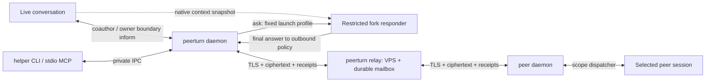

# Дизайн v1

21.10.2026, после решения владельца по M0/M0b. **Проектный контракт**, не готовая реализация: продукт пока Go help/version CLI. Нормативные требования — [requirements.md](requirements.md), trust boundaries — [security.md](security.md), acceptance — [plan.md](plan.md). Новые поля/IPC ниже принадлежат PeerTurn, а не native API Claude/Codex.

Примечание к публикации: частные пути заменены стабильными архивными обозначениями; исходные номера строк сохранены. См. [ключ исторических ссылок](../../README.md#historical-citations) и [английский перевод](../design.md).

## 1. Имя и проверка коллизий

Утверждено **PeerTurn**, executable `peerturn`, каталог `<project-root>`, лицензия Apache-2.0. Ниже сохранён исторический поиск имени; он не является новой проверкой или открытым решением владельца. Локальный каталог скрыт для публикации.

Проверка публичными `curl -sS` 21.10.2026, начата **12:10:31 UTC**: GitHub `https://api.github.com/search/repositories?q=<name>%20in:name&per_page=100`; npm `https://registry.npmjs.org/<name>`. Сверялись `name` без учёта регистра, HTTP status, `total_count`, первые100 результатов. Это проверка коллизий, не регистрация имени или товарного знака.

| Имя | GitHub | npm | Решение |
|---|---|---|---|
| `agent-link` | HTTP200,2269 name-search hits,27 exact в первых100; [Riccardo8888/agent-link](https://github.com/Riccardo8888/agent-link) — «An end-to-end encrypted channel between coding agents, anywhere»; также `dmitry-ra/agent-link` | HTTP200, `agent-link`, latest `0.0.0`; [registry record](https://registry.npmjs.org/agent-link) | Коллизия по имени и назначению |
| `turnlink` | HTTP200,total1, exact [digitARTI/turnlink](https://github.com/digitARTI/turnlink) | HTTP404 [record](https://registry.npmjs.org/turnlink) | Не выбирать |
| `peerturn` | HTTP200,total0 | HTTP404 [record](https://registry.npmjs.org/peerturn) | Рекомендуется; свободность только на момент запроса |
| `sessioncourier` | HTTP200,total0 | HTTP404 [record](https://registry.npmjs.org/sessioncourier) | Запасной вариант, длиннее |
| `agentwire` | Первый запрос HTTP200, exact [tcballard/AgentWire](https://github.com/tcballard/AgentWire), [DanixMP/AgentWire](https://github.com/DanixMP/AgentWire); повтор HTTP403 rate limit, не отрицательный результат | HTTP404 [record](https://registry.npmjs.org/agentwire) | Коллизия |

Перед публикацией повторить exact-name проверку; namespace npm для optional adapter — `@<publisher>/peerturn-claude`. npm не обязателен для установки Go helper.

## 2. Компоненты и процессы



- Один Go binary с subcommands `daemon`, `relay`, `mcp`, `hook` и пользовательским CLI. На клиенте один daemon на OS uid, stdio MCP — тонкий proxy, hook — короткий процесс. Relay может использовать тот же binary в отдельном контейнере. Нет Node/Python daemon в core.
- Daemon держит ключи, durable queues, grants, transport, scope dispatcher и responder supervisor. Минимальный adapter доставляет coauthor, предлагает inform на owner boundary и получает native snapshot handle. Ask ограничивает отдельный runtime/OS, не optional hook и не модель. Live owner permission mode не меняется.
- Client IPC: Unix socket mode0600 в каталоге0700, проверка uid/process incarnation; native Windows позже через named pipe ACL. Не слушать TCP по умолчанию. Mod↔helper — `$.process.spawn` с фиксированным argv и framed stdio; local long-poll HTTP, подтверждённый L1, допустим только как compatibility backend с per-session capability и loopback bind. Прямой stdio mod stream **не проверено**, LAB-CC-IPC; до этого используем L1 long-poll, без plaintext на внешнем relay.
- На relay: HTTP API, WSS event stream, SQLite WAL, bounded workers, один writer transaction path. No broker/Redis/PostgreSQL dependency. SQLite driver — точный pin с проверкой M1; собственный database engine не пишем.
- WSS push — только уведомление о доступных seq; source of truth — durable HTTP mailbox fetch. Переподключение не теряет данные и не запускает модель без нового допущенного input. Clients используют исходящий443, поэтому архитектура подходит для NAT; реальный Internet/TLS/NAT **не проверено**, LAB-NET.

Заимствования: custody/outbox и `in_doubt` из `R1:825`; mesh transport отдельно от authority — `R2`; частный локальный bridge `<sender-resolution>` (`BRIDGE:source-A:24`), `<private-ipc-directory>` (`BRIDGE:source-B:101`), `<registration-cleanup>` (`BRIDGE:source-B:115`), `<asynchronous-receipt-tail>` (`BRIDGE:source-C:41`). Последний пригоден для наблюдения receipts, **не** для синхронного guard: поиск текста в запаздывающем rollout не доказывает происхождение до первого tool.

Не переносим автоматическую публикацию всех Codex threads как pseudo-peers (`BRIDGE:source-D:7`), local unknown-sender delivery, global workspace keys и body control. L2 реально обнаружил fan-out по shared identity и `ctrl:despawn`: `L2-RAW:rt-shared-identity-fanout-result.log:2`, `L2-RAW:agmsg-expert-canary-control.log:2`.

## 3. Identity, ключи и grants

| Сущность | Поля / время жизни |
|---|---|
| `Identity` | `identity_id=SHA256(root_public_key)`, Ed25519 root; display name локальный и необязательный, не authority |
| `DeviceCertificate` | Root-signed JWS: `device_id`, Ed25519 device public key, validity, `device_epoch`; root key не требуется daemon для каждой отправки |
| `SessionCertificate` | Device-signed JWS: random `session_id`, `session_epoch`, Ed25519 session signing key, X25519 recipient encryption key, `key_epoch`, expiry. Native UUID/cwd/socket не уходят на relay |
| `LocalBinding` | `session_id → platform/native_session_id/instance_id/native_process_start/uid/adapter_build`; связь с конкретным execution context, не имя |
| `Grant` | Recipient session подписывает: `grant_id`, issuer identity/device/session/epoch, subject identity/device/session/epoch/signing key, `scope`, `grant_epoch`, `not_before`, `expires_at`, limits, allowed reply route; default policy authority local, optional `policy_authority_key/policy_epoch` другого owner device только для policy leases/revoke. Ни wildcard sessions, ни право peer выдавать grants |
| `RoutePermit` | Независимый relay ACL: mailbox owner разрешает routing public key писать в один mailbox до expiry с quota/permit_epoch. Не раскрывает scope, session name или message body |

По умолчанию grant на24 h, продление по заранее согласованной owner policy; maximum30 d, явный expiry. Два направленных grants создаются при join: владелец заранее выбирает scope коллеге→себе; коллега подтверждает свой scope владельцу→себе. Доверие собственному второму устройству не означает auto-attach всех его сессий. Team — адресная книга и явный fan-out N независимых подписанных/зашифрованных сообщений; team admin не может выдать grant чужой receiving session.

Root keys генерируются/хранятся локально; export/import нового устройства — отдельная owner операция. OS keychain хранит wrapping key, файлы keys0700/0600, memory-only unlocked keys; Linux без keychain использует явный encrypted keyfile/passphrase при старте либо явно выбранный file-permissions mode. Копирование state directory не считается разрешённым переносом identity. Device/session private keys не передаются relay, LLM или peer. Local compromise same uid остаётся за границей защиты.

## 4. Криптографический профиль

Выбран **HPKE RFC9180 Base mode**, suite `DHKEM(X25519,HKDF-SHA256)` / `HKDF-SHA256` / `ChaCha20Poly1305`, IDs `0x0020/0x0001/0x0003`, плюс **Ed25519 JWS** для подписи certificates, grants и внутреннего payload. HPKE решает асинхронное шифрование для offline recipient; sender authenticity даёт проверенная подпись, а не Base mode. Никаких собственных DH-combine, nonce schedule, ratchet или «усилений» алгоритма. [RFC9180](https://www.rfc-editor.org/rfc/rfc9180.html), [JWS EdDSA/RFC8037](https://www.rfc-editor.org/rfc/rfc8037.html).

Go baseline для реализации — закреплённый supported patch release с публичным `crypto/hpke`; при проверке документации доступна **go1.27.2**, включая DHKEM/X25519, HKDFSHA256, ChaCha20Poly1305 и `NewSender`/`NewRecipient`. Используем `crypto/ed25519`, `crypto/ecdh`, `crypto/rand`, `crypto/sha256`; Go stdlib HPKE, а не копию псевдокода RFC. Конкретный toolchain/digest фиксирует M1; наличие API на машине сборки **не проверено**. [Документация Go HPKE](https://pkg.go.dev/crypto/hpke).

HPKE context новый на **каждое** сообщение; `NewSender` → один `Seal(aad, plaintext)`, затем уничтожить context. Wire хранит отдельные `enc` и `ciphertext`; повтор сети передаёт тот же ciphertext, не шифрует заново. `info` — фиксированный ASCII `peerturn/v1/envelope`; AAD — точные UTF-8 bytes canonical routing header, содержащего version, suite, destination mailbox, permit ID, message ID, recipient key epoch, expiry. Header сериализуется один раз по RFC8785; parser запрещает duplicate keys/неизвестные critical fields. Relay-assigned seq не входит в подпись sender: он появится позже.

Внутри HPKE — JWS Compact Serialization над JSON payload; `alg=EdDSA`, только Ed25519, fixed `typ=peerturn-message-v1`, protected `kid`; никакого `none`, algorithm negotiation, `jku`/`x5u`/remote key fetching. Проверка идёт над исходными payload bytes JWS до JSON parse; canonical form нужна для предсказуемых digests, не вместо проверки подписи. Подписаны destination, IDs, grant hash/epoch, body, conversation chain. Композиция стандартов — наш application profile, требующий interop/security review M1; это не заявление о независимом аудите продукта.

| Альтернатива | Почему не основа v1 |
|---|---|
| Noise | Хорош для online authenticated stream и FS при корректном pattern; offline store-and-forward потребовал бы ещё durable session/ratchet lifecycle. Не реализуем собственное расширение. Public keys всё равно надо pin. `R3-N:sec-noise.txt:868`, `:919` |
| age v1 | Надёжный готовый file/container format, пригоден для encrypted backup; sender authentication и session grants всё равно отдельные. Для коротких typed messages выбран HPKE с AAD; age не даёт нужную delivery semantics сам. [age specification](https://age-encryption.org/v1) |
| MLS RFC9420 | Даёт group epochs, FS/PCS; оправдан для больших динамических групп, но избыточен для pairwise grants команды3–10. MLS требует отдельного выбора Go implementation и interop, это v2 research. [RFC9420](https://www.rfc-editor.org/rfc/rfc9420.html) |

**Не обещаем forward secrecy/PCS**: компрометация действующего recipient private key раскрывает сохранённые ciphertext этого key epoch. Суточная rotation с удалением старых ключей уменьшает окно, но не превращает HPKE в double ratchet; резервные копии могут расширять его. Если FS становится обязательным, нужен отдельный стандартный messaging stack/MLS milestone, не самописные prekeys.

## 5. Envelopes, очереди и receipts

```text
RoutingHeader = {wire_version, suite, dst_mailbox, route_permit_id,
                 message_id, recipient_key_epoch, expires_at}
EncryptedPacket = {header, enc, ciphertext}
MessagePayload = {message_id, from_session, from_session_epoch, to_session,
                  to_session_epoch, sender_seq, grant_id, grant_epoch,
                  grant_hash, kind, body_utf8, created_at, expires_at,
                  conversation_id, parent_id?, reply_to?, hop, budget_id}
ReceiptPayload = {message_id, attempt_id, stage, evidence_kind, at,
                  delivery_context, outcome?, reason_code?}
LocalRun = {run_id, message_id, attempt_id, parent_binding, snapshot_handle,
            fork_native_id?, model, effort, profile_hash, budget_id, state}
```

`kind` — `inform|ask|coauthor|reply|receipt|key_update|grant_update|revoke`; последнее семейство обрабатывает core, никогда не модель и не substring parser. Grant scope и kind проверяются на совместимость; `reply` разрешён только в существующем conversation к подписанному peer, не любому адресу. Control objects подписываются именно уполномоченным issuer; scope не берётся из `kind`.

`message_id` —128 случайных бит, `sender_seq` — monotonic uint64 per directional session channel. Relay `mailbox_seq` — monotonic per mailbox, назначается в транзакции одновременно с UNIQUE(sender route key, message_id) и ciphertext digest. Equal ID/equal digest возвращает прежний receipt; equal ID/different digest →409. Retries 0.5…30 s exponential backoff+jitter, с TTL, неизменным ID/ciphertext; credential refresh не меняет message ID.

Receiver атомарно сохраняет ciphertext, validated metadata, dedup, grant decision и receipt outbox; после commit допустим cumulative ACK. Перед live submit/fork start/inform boundary повторяет grant/expiry/binding/capability checks. Persist `delivery_intent/attempt_id` предшествует native вызову, затем фиксируется queue ID или LocalRun. ACK — custody, не model input. Дубликат возвращает прежнюю receipt, не запускает новую модель.

Crash между submit/spawn и result → `in_doubt`, reconciliation по IDs/native events; неизвестный ответ не пересылается. Исчезновение queue item не доказывает consumption. Нет blind retry/fallback ни для coauthor effects, ни для оплачиваемого ask. Явный owner retry — новый message ID с `retry_of` и предупреждением о повторном эффекте/расходе. Supervisor привязывает child process group к run; после crash admission закрыт до reconciliation, orphan output не становится reply.

Ask lane: `receiver_stored → responder_started → responder_input → responder_completed → reply_redacted → reply`; живой adapter lane сохраняет `adapter_accepted → model_input → turn_completed`. Inform заканчивает storage без wake, затем может получить owner_mixed model_input. Final answer целиком буферизуется локально, tool events/partial output peer не стримятся. Redaction и grant/expiry check предшествуют атомарному reply outbox commit. Native IDs/snapshot handles — только local metadata; encrypted peer receipts содержат opaque attempt ID и sanitized outcome, relay видит ciphertext.

Mailbox ACK принимает только highest contiguous durable seq; gaps сохраняются. Expired/invalid записи создают bounded tombstone для продвижения cursor без plaintext. `sender_seq` обнаруживает replay/gaps даже при злонамеренном relay reorder; абсолютный global order между peers не обещается. Receipts идут отдельной encrypted control lane с reserved quota, не создают response-to-receipt и не будят модель. Детальные стадии — requirements §5.

## 6. Relay API и деплой

Все API — HTTPS; WSS только transport notifications. Request auth — **RFC9421 HTTP Message Signatures**, Ed25519 routing key, покрывает method, authority, target URI, Content-Digest, created/expires и nonce; body digest реально проверяется. Clock skew±60 s, request lifetime≤60 s, durable replay cache≥2 min для mutations. Уточнение M2 hardening: GET использует отдельный bounded volatile replay cache до конца acceptance window, без fsync; после restart ещё-valid GET может повториться, но не выполняет ACK/delete/claim. Authority обязана совпадать с настроенным public authority relay; между endpoints подпись не переносится. [RFC9421](https://www.rfc-editor.org/rfc/rfc9421.html); сохранённое исследование `R3-N:sec-rfc9421.txt:3346`.

| Endpoint | Назначение / авторизация |
|---|---|
| `GET /.well-known/peerturn` | Version ranges, public limits, relay key; не источник E2E trust |
| `GET /i/{invite_id}` | Статическая HTML/agent-readable инструкция и public bootstrap manifest reference; GET не redeem |
| `POST /v1/mailboxes` | Scoped enrollment voucher или локальный relay-admin; один bound read key, quota; admin credential не уходит peers |
| `GET /v1/invites/{id}` | Encrypted descriptor, public invite proof key, expiry; no plaintext grants |
| `POST /v1/invites/{id}/claims` | Signed invite proof + encrypted claim; атомарно reserve single use; повтор same claim idempotent |
| `PUT/DELETE /v1/mailboxes/{id}/permits/{permit}` | Только mailbox owner routing key, monotonic epoch; уже открытые streams переоцениваются |
| `POST /v1/mailboxes/{id}/messages` | Valid route permit + bound writer signature; commit→seq receipt; размер≤96 KiB ciphertext |
| `GET /v1/mailboxes/{id}/messages?after=…&limit=…` | Только mailbox read key, limit≤100, bounded long poll |
| `POST /v1/mailboxes/{id}/ack` | Read key, contiguous cursor; reject ACK beyond issued range |
| `GET /v1/events` →WSS | Authenticated upgrade, notifications `{mailbox, high_seq}`; no content, grants/scopes or native IDs |
| `POST /v1/streams/tickets` | One-use≤60 s ticket только notify lane Monitor; не mailbox content/read token |
| `/healthz`, `/readyz`, `/metrics` | Health без secrets; metrics/admin на localhost/private bind |

Status codes:400 schema,401 authentication,403 permit,409 ID/epoch conflict,410 expired/revoked invite,413 size,426 unsupported major,429 quota+Retry-After,503 storage/backpressure. Нет execute/spawn/read-file/list-native-sessions API. Регистрация mailbox не даёт возможности писать в чужие mailboxes.

Self-host: `peerturn relay --config /etc/peerturn/relay.toml`, persistent `/var/lib/peerturn`, TLS certificate/key через файловые secret mounts. Один бинарник умеет TLS termination; альтернативно reverse proxy Caddy/nginx с доверенными proxy headers только от заданных IP. Domain+A/AAAA+ACME выдача сертификата — шаги оператора. Docker image pinned digest, non-root, read-only rootfs, dropped caps, writable только data/tmp, memory/CPU limits. TLS≥1.2, предпочтительно1.3; без insecure skip verify.

Relay restart сохраняет mailbox seq, dedup/tombstones, invites/claims/permits, quota и backup epoch. SQLite WAL full durability, consistent online backup, daily restore drill M7; quota default1 GiB, mailbox≤1000 items/32 MiB, no silent eviction. При ENOSPC новые writes получают503; `relay_stored` до commit не выдаётся. Backup защищает ciphertext/metadata, но не private client keys. Один relay-instance в v1, без multi-writer HA/federation; клиент может иметь связи на нескольких независимых relay.

## 7. Один URL: end-to-end onboarding

Пример **формата**, не действующий сервис:

```text
https://relay.example/i/<random-128-bit-id>#v=1&ik=<invite-signing-seed>&ek=<invite-decryption-key>&fp=<inviter-root-fingerprint>&mh=<descriptor-hash>
```

`ik` Ed25519 seed и `ek` X25519 private key независимы, генерируются `crypto/rand`; никакой конверсии Ed25519→X25519. Приглашение — short-lived proof capability, не encryption/message key действующей сессии. Descriptor — HPKE encrypted к invite encryption public key, внутри inviter-signed invitation: обе proposed scopes, recipient session certificate, relay origin, expiry10 min, max_uses1, publisher/release manifest hash и enrollment voucher для одного нового mailbox. Relay видит ciphertext, invite verification public key и routing/expiry metadata. Секреты находятся во fragment и не передаются HTTP GET; **полный pasted URL всё равно видит model provider/transcript**.

1. В owner turn `peerturn invite create --current --scope ask --return-scope ask` проверяет текущий binding и формирует одноразовый URL. Другие scopes задаются явно. Inviter daemon сохраняет invitation authority локально; relay получает opaque descriptor и слот.
2. Коллега вставляет один URL в агент. Fetch URL без fragment отдаёт одинаковую короткую инструкцию и versioned manifest; link preview не активирует grant. Установленный helper берёт полный URL из stdin; новый агент получает официальный подписанный bootstrap по известному publisher origin, а не исполняет произвольный shell с relay page.
3. Свежая установка: скачать точный OS/arch artifact, manifest/signature, проверить trusted publisher key/hash, распаковать user-local helper и адаптер. Первый trust root должен прийти из trusted distribution/уже установленного package manager либо явного human acceptance publisher; подпись ключом, взятым с той же неизвестной страницы, не доказывает доверия. Команды product bootstrap описаны в §10; существующий helper сразу делает `peerturn join --link-stdin --current`.
4. Helper показывает **одну карточку**: publisher/version, inviter fingerprint/name, две конкретные sessions, оба scopes, expiry, сохранение bypass, фактические limitations. Человек подтверждает контакт/install один раз; sender issuance уже является разрешением владельца. Native host hook-trust dialogs не обходятся и учитываются отдельно; лаборатория пока не доказывает ровно один total click на всех hosts.
5. Helper получает current-session evidence по правилам ниже, создаёт session keys, расшифровывает descriptor, проверяет signature/fingerprint/hash/expiry. Claim содержит новый session certificate, обратный recipient-issued grant, requested scope subset, `claim_id` и routing keys; собственная session подпись внутри HPKE к inviter. Снаружи invite-key signature покрывает invite ID, claim ciphertext hash, claim ID и expiry. Relay reserve и inviter-local consume выполняются атомарно каждый у себя; второй другой claim отвергается даже если relay злонамеренно повторяет их.
6. Inviter daemon проверяет proof и собственный unused slot, issued policy, claims; выпускает точный forward grant и route permit. Ответ E2E к joiner key. Повтор после потерянного ACK возвращает тот же результат; не тратит use заново. Offline inviter → `waiting_inviter`, без ложного connected; «just works» предполагает доступный signer или его заранее scoped local service.
7. После scope-specific capability probe и signed hello — `connected` с реальными supported scopes. `fork_responder=false` запрещает ask, но не coauthor/inform. Hello привязан к выбранной live session; созданный для ask fork не подменяет её identity. L1 ошибка нового thread вместо attach — `L1:157`.

### Claude Code

Agent Bash запускает проверенный helper; он получает `CLAUDE_CODE_MESSAGING_SOCKET` и token из child env, **не печатая token**. Публичный контракт экспорта: `CC-DOC:cross-session-messaging.md:244`, `:251`; отдельный end-to-end join по этому env в L1 **не проверено**, LAB-BIND-CC. Нельзя искать «последний Claude по cwd». Сокет связывается с OS peer credentials/process start; mod сверяет `$.session.id()` и helper nonce handshake. Native UUID+process incarnation должны совпасть; mismatches→`needs_rebind`.

Helper ставит локальный signed plugin через проверенный local-path installer: `claude plugin install peerturn --marketplace <verified-local-marketplace> --scope local`; upstream URL install описан в docs, но live тестировал local paths. `/reload-plugins` выполняет человек, если host не предоставляет агенту проверенный command dispatch. First activation при необходимости — **resume прежнего UUID**, не новая сессия. Отдельно проверить hook/tool visibility перед hello; L1 наблюдал native dispatcher только после activation: `L1:165`.

Live coauthor: Go receiver → mod → `$.prompt.submit({text})`, **без `asUser:true`**; `drop` — не delivery. Это unrestricted запрос с явным verified peer framing. L1 подтвердил DeepSeek wake/queue и plugin origin (`L1:64`, `L1-RAW:62-transcript-mod.json:12`); synchronous required-guard mapping для coauthor не нужен. Ask не вызывает submit: native fork профиль — §8. Inform — local storage/status и mod UI, где доступен; body только на следующем owner boundary, без submit/wake.

Native inbox совместим только с coauthor после отдельного qualification: проверенный `peerProtocol=1`, auth + NDJSON, escaping, OS identity; не лгать `from-mode`. L1 видел between-tools delivery (`L1:40`, `:56`, `:195`), поэтому это не default next-turn путь. Для inform/ask native inbox и asyncRewake запрещены. Channels/Monitor не заменяют scope dispatcher.

### Codex CLI

Helper внутри tool child получает `CODEX_THREAD_ID`; источник добавления env — `CX-SRC:protocol/src/shell_environment.rs:165`. `thread/loaded/list` + exact `thread/read` проверяют, что этот UUID обслуживает **тот же** shared daemon, его local endpoint владельцу не заменяется новым server. Current-session env→join **не проверено**, LAB-BIND-CX. `--no-daemon`/embedded TUI → явный unsupported live attach, без «исправления» новым exec/resume процессом.

Helper устанавливает pinned local marketplace/plugin (`codex plugin marketplace add <verified-path>`; `codex plugin add peerturn@peerturn-local`), добавляет local stdio MCP и hooks. MCP config runtime обновляется проверенным `config/mcpServer/reload`; live activation hooks отдельно probe. Один native экран **Hooks need review / Trust all** реален даже в YOLO: `L2:60`, `L2-RAW:agent-talk-codex-hook-trust.log:1`. Нельзя утверждать, что never снимает hook trust. Если требуется restart/resume, только explicit same UUID, с проверкой не затронуть соседние threads.

Live coauthor: `codex queue` к exact loaded UUID / pinned `thread/queue/add`, сохраняются queue/client IDs для receipts/reconciliation. L1 FIFO/idle — `L1:120`, `L1-RAW:59-transcript-codex.json:12`. Queue→turn evidence может быть observed, не выдуманный synchronous fence (M0 `M0:94`). `turn/start` при гонке может steer; peer steer/raw inject v1 не экспортируются. Ask — отдельный `codex exec … fork`, §8; inform не ставится в native queue.

### Gemini CLI

Пакет — pinned extension с hook commands на Go helper; documented `gemini extensions install <verified-repo> --ref <sha>` с install consent, либо локальный validated package путь после LAB-JOIN-GEM. MCP optional, отправка через helper работает и без hot MCP. `SessionStart/BeforeAgent` передают `session_id`, hook+child registration nonce связывает UUID с pending join; конкретная environment переменная **не предполагается**. Два concurrent sessions из одного cwd не имеют права конкурировать за «pending join by cwd».

Baseline inform — `BeforeAgent.additionalContext` следующего owner prompt; в idle pending. Ask без собственного fork profile → `responder_unavailable`; `AfterAgent` не запускает restricted peer turn. Boundary coauthor возможен как unrestricted owner_mixed с явной capability. Restart/resume для activation может понадобиться; `/mcp reload` не доказывает hot add. Sources: `GEM-SRC:docs/hooks/reference.md:114`, `:245`; `R3:248`, `:261`. End-to-end **не проверено**, LAB-BOUNDARY-GEM.

### Antigravity / agy

Agent ставит signed helper/plugin (`agy plugin install <source>`). Не выдумывать `agy mcp add`. Join binding: **`conversationId`** + process instance; `workspacePaths` только display, env UUID **не проверено**. `PreInvocation` следующего owner turn предлагает inform как escaped `ephemeralMessage`; никогда peer-controlled `systemMessage/toolCall`. `wake_idle=false`, `fork_responder=false`; ask → `responder_unavailable`, coauthor только в явно заявленном unrestricted boundary режиме.

Hook fields и injectSteps: `R3-N:ext-antigravity-hooks.txt:372`, `:490`; install: `R3-N:ext-antigravity-plugins.txt:284`; `/mcp` reload: `R3-N:ext-antigravity-mcp.txt:203`. Hook reload, trust dialogs, exact current-session handshake **не проверено**, LAB-JOIN-AGY. Restart/resume лишь по подтверждённому runtime contract, иначе `needs_activation`; не переключать на headless stream-json и не объявлять его прежним TUI.

### Copilot CLI

Signed helper + pinned plugin (`copilot plugin install <verified-source>`). Hook binding — `sessionStart.sessionId` + process instance; `source=startup|resume|new` не означает human/peer. Inform на следующем owner prompt через `userPromptTransformed` с сохранением owner prompt и data framing; command/HTTP `userPromptSubmitted` output **игнорируется**. Ask без fork profile → `responder_unavailable`, coauthor только явно заявленный unrestricted boundary. `postToolUse.additionalContext` ограничен10KB и не выбран как mid-turn ingress.

Источники: `R3-N:ext-copilot-hooks.md:285`, `:300`, `:404`, `:407`, `:751`. Native Notification wake и SDK `source=agent-…` — отдельные будущие paths, не доказанный attach к текущей TUI (`R3-N:ext-copilot-sdk-steering.md:20`, `R3-N:ext-copilot-sdk-debugging.md:397`). Hot plugin hooks **не проверено**, LAB-JOIN-COP. `/restart` затрагивает **все** live sessions процесса, поэтому helper не вызывает его автоматически (`R3-N:ext-copilot-reference.md:589`).

### Optional Claude Monitor: действительно без установки

Host lab: Monitor `ws://127.0.0.1:18795` после завершения хода получил task-notification и сам разбудил idle; **факт**, несмотря на документированное network restriction: `MONITOR:6`. На DeepSeek инструмент отсутствовал, поэтому probe capability обязателен. 30-min lifetime и 200-ms batching — описание tool, их продолжительный live тест **не проверено** (`:10`).

Flow: link → подтверждённый notify-only invite → короткий one-use stream ticket → `Monitor({ws:{url:"wss://relay.example/notify/<ticket>"},timeout_ms:…})`; ticket после upgrade заменяется server-side subscription, URL secret redacted. Кадр содержит только `mail_available` и routing sequence, **не peer body**. При expiry агент может открыть новую подписку, расходуя дополнительный turn; reconnect, flow limits и получение ticket без постоянного credential — LAB-MONITOR.

Это экспериментальный notify-only path, `e2e_content=false, fork_responder=false, content_delivery=false`, не полноценный мост. Его idle wake **несовместим с v1 inform и ask FYI**, поэтому на эти события Monitor не подписывается; отдельный opt-in эксперимент не считается FR-11. Relay plaintext запрещён, E2E fetch требует проверенный local decryptor. Monitor не заменяет durable ACK, session continuity или installer trust.

## 8. Fork responder, snapshots и lifecycle

### 8.1 Scope dispatcher и запуск

`coauthor` — только live adapter с нормальными возможностями receiving agent; owner pending work имеет приоритет. `ask` — только daemon-supervised fork; `inform` — durable storage/status/UI и data framing на следующем owner turn. Ask FYI configurable: default только status/count в UI без wake; body/answer по умолчанию в live не попадают. Авто-FYI никогда не вызывает submit/queue/Monitor. Owner может явно открыть inbox/result в своём unrestricted ходе.

Daemon перед spawn проверяет exact parent binding/epoch, grant, budget и квалифицированный restriction profile; сохраняет `LocalRun`, native snapshot boundary, effective model/effort. Обязательный preflight изолирует **authority secrets**: PeerTurn private keys, unlocked state/admission/grant-control credentials, mailbox/routing tokens и live-control IPC. Ни files/env, ни inherited descriptors/process inspection не должны отдавать их responder tools. Clean env/отсутствие MCP недостаточны. Без доказанной изоляции → `protected_path_policy_failed`, без spawn/ответа. Fork не получает peer grants/mailbox; stdout final answer подписывает только daemon к исходному verified peer. Body не формирует argv/settings/native IDs. Разовая child correlation не auto-attach.

Claude baseline из `M0b:10`:

```sh
claude -p --resume <live-id> --fork-session --permission-mode default \
  --allowedTools Read Grep Glob \
  --disallowedTools Bash Edit Write NotebookEdit WebFetch WebSearch Task \
  --settings <private-responder-settings.json> --output-format json
```

M0b проверил tool removal Write/Bash, Read и контекст; `--settings` path policy в этой пробе **не проверено** (`:14`, `:37`). `--allowedTools` означает разрешение без prompt, не закрытый tool inventory: `CC-DOC:cli-reference.md:67`. Hardened профиль должен дополнительно фиксировать built-ins через `--tools Read,Grep,Glob`, deny `mcp__*`, отключать skills/commands и inherited hooks/plugins/MCP с эффектами. `--tools` / `--strict-mcp-config` документированы (`:138`, `:131`), их полный fork composition **не проверено**, LAB-FORK-CC. Неизвестный tool/integration → профиль не квалифицирован, ask выключен; approval prompt не превращается в owner approval.

Candidate settings, **не проверено live**, генерируются daemon в private regular file; реальные абсолютные пути вычисляются локально, пример не полный policy:

```json
{"permissions":{"deny":["Read(//<user-home>/.ssh/**)","Read(//<user-home>/.aws/**)","Read(//<user-home>/.local/state/peerturn/**)","Read(//work/project/.env*)"]}}
```

Документированный `//` — filesystem root; `/` зависит от settings location. Приоритет deny→ask→allow и path syntax: `CC-DOC:permissions.md:58`, `:352`, `:362`, symlinks `:459`. LAB-FORK-PATHS проверяет effective merge с resume/default, Read/Grep/Glob, aliases/symlinks/races и все protected roots из security §6. Unmatched/ignored rule — `protected_path_policy_failed`, без ответа. Не выдавать snippet за подтверждённую защиту всех путей.

Codex baseline из `M0b:26`:

```sh
codex exec -c sandbox_mode='"read-only"' -c approval_policy='"never"' \
  fork <live-thread-id> "<question>"
```

Это иллюстрация native CLI, не способ интерполяции peer body в shell: реализация использует фиксированный argv/private input. `-c sandbox_mode` ставится **до** `fork`; `--sandbox` после fork не принимается (`:28`). Effective sandbox/network/approval и same model/effort проверяются до peer input; explicit overrides разрешены только для сохранения исходных model/effort и отдельного restriction profile. Tool network off не отменяет необходимую runtime→model-provider связь. Runtime metadata/transcript writes вне tool sandbox возможны; «read-only» не означает ноль writes самим host.

Linux: bwrap требует разрешённых **unprivileged user namespaces**; одного sysctl недостаточно при AppArmor/seccomp/container policy. `doctor` и activation выполняют sandbox preflight в том же launch environment: разрешённый fixture read, отклонённые write и tool-network canaries. Ошибка userns/bwrap → `sandbox_unavailable`, `fork_responder=false`, нет tool execution/unrestricted retry; owner/coauthor отдельно продолжают. M0b отказ и RO canary — `:30`; source diagnostic `CX-SRC:sandboxing/src/bwrap.rs:28`. `seccomp=unconfined` был lab условием, не автоматическим production исправлением; host policy не ослабляется.

macOS: Codex использует Seatbelt (source `CX-SRC:core/src/sandboxing/mod.rs:179`); live fork+Seatbelt **не проверено**, LAB-FORK-CX. Source RO network off — `CX-SRC:protocol/src/protocol.rs:1314`, требуется live negative probe. Shell isolation не доказывает безопасность MCP/hosted tools: effectful services исключены. Stock RO допускает широкое чтение и **не проходит authority-isolation gate сам по себе**. Нужен доказанный native read-deny/изолированный file view либо credential broker/service account с закрытыми state/IPC/process handles; native fork/provider auth composition **не проверено**, LAB-FORK-PATHS. После обязательной изоляции authority чтение прочих файлов остаётся residual, `protected_paths_enforced=false` не означает разрешение читать signer/admission secrets.

### 8.2 Context, framing, concurrency и cost

Полный native context наследуется локальным fork, не отправляется peer/relay и не собирается в attachment. Сохраняем model/provider ID, effort, persona и native compaction; без summary/дешёвой модели. Context может содержать пользовательские secrets/injection — residual. Известный core exposure действующего authority secret блокирует ask до revoke/rotation/rebind, без урезания owner history. Framing добавляет verified peer fingerprint, scope/epoch, owner-authorized read/analyze/reply, ограничения/budget и вопрос как data field. Оно не делает peer владельцем и не разрешает раскрывать secrets. DeepSeek over-refusal (`M0b:19`) требует benign acceptance, не ослабления runtime policy.

Snapshot — committed native conversation prefix на конкретном boundary. Busy live session: использовать доказанный immutable prefix либо ждать boundary; torn transcript → `snapshot_unavailable`. Owner продолжает работу. Фиксируем local boundary/context revision и effective model/effort; наследование всех memory/plugin slots и atomic snapshot на busy runtime **не проверено**, LAB-MIX/FORK-CC/CX. Файловая система при чтении остаётся живой: это не atomic code snapshot, ответ может устареть; fork ничего не merge'ит обратно в live. Для reproducible code snapshot нужен отдельный явно выбранный fixture/worktree, не скрытая копия пользовательских файлов.

Baseline receiver limits (проектные, **не проверено**, LAB-FORK-COST): один active fork на parent session, два на daemon, один outstanding ask на conversation; FIFO admission/fair peers, bounded wait/TTL. При явном увеличении parallelism каждый run имеет отдельные native ID/snapshot/budget/output, completion может переупорядочиться. Нельзя re-resume один responder для разных grants или принимать late output отменённого run. Owner нагрузка приоритетна, child CPU/RSS и model costs видны отдельно.

Каждый ask резервирует budget до spawn: default deadline120s, ≤8 tool calls, final output≤16KiB, estimated cost≤$1/run и ≤$10/day/daemon; owner policy может изменить. Provider usage/pricing/currency фиксируются локально; prefix cache — возможная экономия, не гарантия. Если денежный ceiling нельзя достоверно оценить/контролировать, ask не стартует (`responder_unavailable`, reason `budget_unavailable`), а не unlimited. Native cap + supervisor deadline/output/resource cap, kill child group и reconciliation; cap overshoot/in-flight billing возможны и раскрываются. Cost guard не уменьшает model/effort/context; превышение → `responder_failed:budget_exceeded`, без partial reply. Точные token ceilings, cached usage и provider accounting квалифицирует LAB-FORK-COST, не M0b.

### 8.3 Lifecycle и ошибки

Session состояния: `unbound → joining → probing → active → offline|paused_owner|needs_activation|needs_rebind|in_doubt → active|revoked|closed`. Ask capability отдельно: `ready|responder_unavailable|sandbox_unavailable|unverified`; local run: `reserved → starting → running → completed → redacting → reply_committed|failed|cancelled|in_doubt`. Совпадающий session key/epoch допускает один live instance lease; отсутствие lease закрывает новые admissions, не owner tools.

Same-UUID resume на том же device сохраняет grants после keys+host handshake и смены instance/PID-start. Rename — label. New UUID, `/clear`, branch/clone, device/key loss → новая identity/epoch; responder исключён лишь как local child, не получает собственных grants. Session events после `/clear`/`/resume`/`/branch` перепроверяются (`R3-N:claude-mod-reference.md:138`). Parent epoch change/revoke отменяет run и запрещает reply; running syscall/уже прочитанный context не откатить.

Esc/Stop live session ставит `paused_owner` и запрещает новые автоматические admissions; активные responders отменяются supervisor, late output отбрасывается. Нет auto-retry обхода остановки. Owner input re-arms только по local owner policy. `drop`/interrupted queue — не consumption (`L1:81`, `R3-N:codex.md:34`). При timeout/crash/sandbox/profile/redaction error — нет ответа + typed receipt; если сам daemon недоступен, receipt durable после recovery, peer пока видит pending/in_doubt.

## 9. CLI, MCP, storage и status

| Surface | Контракт |
|---|---|
| CLI owner | `init`, `join --link-stdin --current`, `invite create`, `grants list/revoke`, `session bind/status/disconnect`, `doctor`, `update --check/--apply`, `relay` |
| CLI message | `peers --json`, `send --peer <id> --kind ask --stdin`, `reply --message <id> --stdin`, `inbox --json`, `receipt <id> --json`, `status --json` |
| MCP tools | `peer_list`, `peer_send`, `peer_reply`, `peer_inbox`, `peer_receipt`, `peer_status`; no arbitrary recipient key/URL/native UUID argument |
| Local adapter IPC | `bind_probe`, `capability_probe`, `live_submit`, `inform_offer`, `snapshot_acquire`, `responder_start/cancel/observe`, `receipt_observe`; private authenticated adapter/process, не remote MCP |
| Errors | Stable `code`, actionable `message`, `retryable`, `state`; CLI JSON on stdout, diagnostic on stderr; exit0 success,2 input/policy,3 binding,4 transient,5 auth/crypto,6 unsupported,7 in_doubt |

MCP instance получает session-bound private capability через IPC handshake; cwd/config scope не authority. Без доказанного caller binding → `unbound`. Autodiscovery не показывает чужие local sessions. Responder не получает PeerTurn MCP или owner control endpoints; stdout final answer не является MCP command. `coauthor` имеет обычные возможности, поэтому controls не объявляются недоступными ему при bypass.

Layout: `$XDG_CONFIG_HOME/peerturn/config.toml`; `$XDG_STATE_HOME/peerturn/{state.db,keys/,audit/}`; `$XDG_RUNTIME_DIR/peerturn/<uid>/daemon.sock`. macOS fallback `~/Library/Application Support/PeerTurn/`, caches `~/Library/Caches/PeerTurn/`; Windows mapping только после OS qualification. Ни state, ни credentials в repository `.mcp.json`. Generated host config содержит absolute helper path, adapter version и opaque local binding reference, не E2E private key.

Logical client records: identities/devices/sessions/bindings/grants/invites/outbox/inbox/delivery_attempts/responder_runs/budget_reservations/receipts/dedup/revocations. Это не SQL schema; новые responder schema/migrations требуют отдельного явного разрешения владельца до реализации. Bodies/results в at-rest encrypted blobs; metadata plaintext локально, permissions0700/0600. Product plaintext history по умолчанию не хранится; native host/fork transcript управляется runtime, его шифрование/удаление не обещаем. Dedup/tombstones≥max TTL+7d, audit30d, disk quota явная.

`status`: fingerprints, local native UUID, runtime/profile hash и capabilities `{attach_existing,wake_idle,boundary_delivery,fork_responder,e2e,receipt_stages}`; `wake_idle` только coauthor. `guarded_peer_start` отсутствует в v1. Показаны supported scopes, evidence/last_verified_at, обязательный `authority_secrets_isolated`, отдельный `protected_paths_enforced`/read exposure, grant expiry, inform count, queue age, active forks, budgets, sandbox health/in_doubt. Labels: «сохранено», «модель получила», «responder завершён», «ответ отправлен». Metrics без body/paths: latency, sanitized failures, bytes, fork duration/resource/estimated cost. Unverified отличается от unsupported; audit без body/full URL/token.

## 10. Репозиторий, совместимость и выпуск

```text
go.mod; cmd/peerturn/{main,client,daemon,relay,mcp,hook}.go
internal/{identity,crypto,protocol,grant,invite,mailbox,store,transport,responder,session}
internal/adapters/{claude,codex,boundary}; internal/{ipc,observability,update}
adapters/claude/{.claude-plugin,hooks,skills}; adapters/{codex,gemini,agy,copilot}/
api/{schemas,fixtures}; packaging/{docker,systemd,launchd}; release/
research/lab/{scenarios,fixtures,results}; docs/{spec,protocol,operators}
```

Файлы≤400 строк, один владелец на изменяемый файл; generated schemas разбиваются по типам. Go toolchain/modules, adapter runtime targets и package hashes pinned; JS без crypto/queue business logic. Правила не требуют завести все каталоги сейчас.

Wire major (`/v1`) и crypto suite отдельно от binary SemVer. `min/max_supported` + required feature bits в подписанном hello; неизвестный major/required bit → refuse, не permissive downgrade. Native platform manifest содержит tested client/server versions, OS/provider, source SHA, wire schema hash, capability tests. L1 — Claude2.1.306/Codex0.163.0, не гарантия будущих versions. Частный Claude `peerProtocol=1` и Codex experimental queue version-gated; неизвестный build → diagnostic probe/`unverified`, peer automation выключена. Rollout parsing исключительно observation fallback.

Release: reproducible build, SBOM/licenses, checksums, detached Ed25519 signed release manifest, signing key вне обычного CI runner; signing key rotation cross-signed old→new с offline recovery. Artifacts macOS/Linux amd64/arm64, adapters.zip и OCI image digest; unsigned artifacts не устанавливаются. Pinned standard signature verifier/package-manager trust нужен **до запуска** нового helper. Publisher key из arbitrary invite не становится trust root.

Installer — проверяемый minimal script без `curl | sh`: exact download→verify→safe extract→atomic install→merge own config с backup→activation probe. Видны publisher/integration. Uninstall удаляет только наши entries/bindings; пользовательские hooks/exports сохраняются. `update --check` read-only, apply в owner maintenance window, rollback signed artifact при compatible storage. Перед update закрыть admission и завершить/отменить responders; после — заново scope-specific probes. Native live sessions не перезапускаются молча.

Deployment/install/updates **не проверено**, LAB-SELFHOST/LAB-UPDATE. M0 guard verdict и API proposal (`M0:133`) сохранены для v2 и не блокируют v1. V1 зависит от qualified native fork profiles, outbound policy и no-wake inform, не от in-session hook fence. M0b — evidence базового механизма (`M0b:34`), не готовый продукт.
